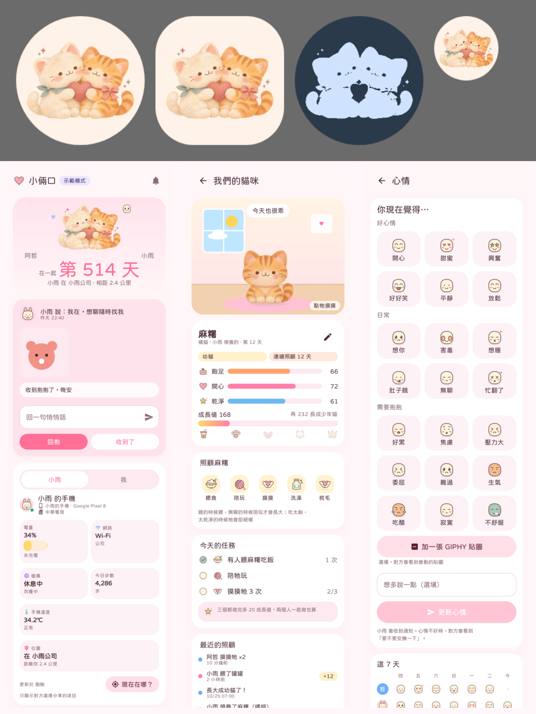

# Android 插畫與圖標

以奶油白、蜜桃、乾燥玫瑰與鼠尾草色為主。雙貓與可養的小貓使用帶紙感的插畫 PNG；功能圖標使用柔和粉彩、圓潤可可色描邊的原創圖案。



## 貓咪與桌面圖示

素材位於 `android/app/src/main/res/drawable-nodpi/`，由本次影像生成工具製作，再做裁切、縮放與 Android 素材打包，沒有外部圖片連線：

| 檔案 | 用途 |
| --- | --- |
| `couple_cats.png` | 透明底雙貓吉祥物，1104 × 789 |
| `cat_coats.png` | 1280 × 1280、4 × 4 等距圖集，每格 320 × 320 |
| `ic_launcher_foreground.png` | 1080 × 1080 的 adaptive icon 前景，中央保留安全留白 |
| `ic_launcher_monochrome.png` | 相同構圖的透明單色遮罩，支援 Android 主題圖示 |

圖集前 15 格以左至右、上至下對應 `Pet.coats`：橘貓、灰貓、白貓、黑貓、三花、賓士、虎斑、橘白、乳牛、玳瑁、美短、英短、摺耳、暹羅、布偶。第 16 格不使用。每格插圖最長邊 260 像素，腳掌基線在約 286 像素，保留透明邊界以免取樣讀到鄰格。

`PetArt.kt` 共用一份解碼後的圖集，使用高品質取樣。不同成長階段保留大小、鈴鐺、蝴蝶結、圍巾與皇冠，照顧道具和心情提示畫在插圖周圍。一般畫面保留呼吸、跳躍與玩耍的輕晃；品種選單使用靜止插圖。

## 介面圖標

`IllustratedIcon.kt` 提供兩個共用入口：

```kotlin
IllustratedIcon(symbol, modifier, contentDescription)
drawIllustratedSymbol(androidCanvas, symbol, left, top, size)
```

後者讓地圖標記、通知與桌面小工具頭像沿用同一套圖案。所有圖案使用反鋸齒繪製，不用字型畫 emoji。心情、安撫、天氣、星座、貓咪用品與動物頭像都有對應圖案。

既有 `emoji:` 頭像和 catalog 的 emoji 字串仍是資料識別值，更新後以插圖呈現，不需要資料庫升級或重設頭像。使用者自己的照片、文字、訊息與備忘錄內容保留。

## 驗證

沿用 `CatsScreensTest`、`PetScreensTest`、`MoreMoodsScreensTest` 等畫面測試產生截圖，檢查圓形／圓角方形／單色桌面圖示、15 種毛色、成長配件、照顧狀態，以及深色、小螢幕和大字體畫面。貼圖載入失敗、動物頭像選擇和地圖定位按鈕另有可讀的協助工具名稱。
