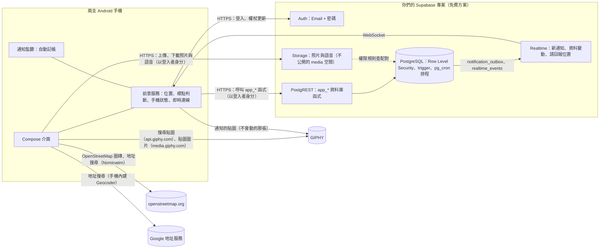

# 小倆口：情侶 App 設計文件

> 一條紅線，牽起兩個人的日常。

小倆口是給已經在一起的兩個人用的 **Android App**，資料存在**你們自己的免費 Supabase 專案**裡。它不取代 LINE，而是補上聊天軟體做不到的部分：**不用開口就知道對方的狀態**（在哪、電量、心情、花了什麼），以及**把在一起的日子記下來**（紀念日、約會、日曆上的生活紀錄、備忘錄、經期、歷史紀錄）。

本文件對應 App 0.2.9（versionCode 11）。

| 文件 | 內容 |
|---|---|
| 本文件 | 產品、介面風格、功能規格、隱私原則、系統架構 |
| [SUPABASE_SETUP.md](SUPABASE_SETUP.md) | 建立 Supabase 專案、執行 setup.sql、在 App 連線、邀請另一半；從舊版更新（upgrade-v2.sql，可以重複執行） |
| [`android/`](../android) | Android App 原始碼（Kotlin + Jetpack Compose） |
| [`supabase/`](../supabase) | 資料庫結構、權限規則、App 呼叫的資料庫函式、即時通知與排程、照片與語音的 Storage 規則 |

---

## 1. 設計原則

| 原則 | 具體做法 |
|---|---|
| **雙向同意** | 兩人各自安裝、各自配對、各自決定分享哪些資料；資料庫預設除了心情以外都不分享。 |
| **透明** | 對方看得到你分享了什麼、何時改了設定；對方新增會偵測你的標點時，你一定收到通知（不能關）。 |
| **可以暫停** | 任何時候可以暫停分享 1 小時、3 小時或到今天結束；對方看到「暫停中、幾點恢復」，不是「失聯」。 |
| **有趣，而不是監控** | 開銷包裝成「猜花費」遊戲；對方心情不好時引導「安撫」，而不是質問。 |
| **資料是你們自己的** | 存在你們自己建立的 Supabase 專案（不是別人的伺服器），權限規則寫在資料庫裡；不用 Firebase，地圖用 OpenStreetMap。 |
| **資料最少化** | 位置只存最新一筆，不保留軌跡；Wi-Fi 名稱不上傳；經期症狀只有本人看得到。 |
| **有些話只給自己** | 給對方寫的備註、私人備忘錄和它的照片語音只有自己看得到，對方連有沒有寫都不會知道。 |

---

## 2. 介面風格：可愛、溫柔、會動

**配色**：櫻花粉為主色，搭配薄荷、薰衣草、奶油黃、天空藍等粉嫩色；兩個人各有代表色（我：天空藍、對方：櫻花粉），在頭像、地圖、帳本裡一致使用。支援深色模式（深莓色底）。

**字型**：全 App 使用 jf open 粉圓（Huninn，SIL OFL 授權），圓潤的繁體中文字型。

**字放大也不會被切到**：畫面測試用 360 dp 寬、系統字型 1.3 倍檢查（身材與尺寸到 1.6 倍）。字放不下就換行，不會無聲無息地切掉：
- 中文用 `TidyText` 換行：盡量在標點、空白後面換，不留孤字，不把數字和單位拆開。
- 真的要限制行數的地方，結尾一定有「…」，點進去看得到完整的：首頁心情的備註 2 行、App 開著時跳出的通知標題 2 行、內文 3 行。
- 並排的按鈕放不下就換到下一排（`ButtonRow`）；同一排的小卡一樣高（`IntrinsicSize.Min`）。
- 窄欄裡不放可能很長的名字：「這 7 天」的心情左邊用頭像，「梓梓的小宝」不會被切成「梓梓」。電話在「-」後面可以換行，別年的日期把星期換到第二行。

**形狀**：大圓角卡片（26dp）、膠囊按鈕、圓滾滾的圖示底；底部分頁是懸浮的圓角膠囊。

**圖示**：Material Rounded 圖示 + 大量 emoji（心情、安撫、類別、標點、提醒都有專屬表情），避開 Android 8–10 不支援的新 emoji。

**吉祥物**：兩顆麻糬（藍色是我、粉色是對方），中間一條紅線牽著跳動的愛心。會上下晃、會眨眼；對方心情不好時，粉色麻糬會嘟嘴掉眼淚。出現在首頁、歡迎頁、配對頁、等待連線頁。

**動畫**（全部用 Compose 原生動畫，不需要額外素材）：

| 動畫 | 用在哪裡 |
|---|---|
| 按下去「啵」一下縮小再彈回來（spring） | 所有按鈕、卡片、標籤、分頁 |
| 愛心飄起來 | 送出安撫、收到抱抱、答應約會、新增紀念日 |
| 彩色紙花 | 猜花費猜到 80 分以上 |
| 心跳放大 | 品牌愛心、在一起天數、紀念日當天 |
| 數字滾動 | 在一起天數、帳本總額、猜花費分數 |
| 長條圖依序長出來 | 帳本類別統計 |
| 經期圓環一格一格畫出來 | 經期頁 |
| 電池動畫 | 電量條動態填滿；低電量變紅並抖動；充電時閃電跳動 |
| 左右搖擺 | 選中的心情、「猜！」標籤、空狀態的小圖 |
| 通知卡片從上方彈下來 | App 在前景時收到通知 |
| 頁面切換、月份切換的滑動 | 導覽、日曆 |
| 底部分頁圖示彈跳上升 | 切換分頁 |

---

## 3. 資訊架構

```
首頁 ─┬─ 吉祥物 + 在一起第 N 天 + 對方在哪、相距多遠
      ├─ 收到的安撫（最近 3 天收到、還沒看過的最新一則：貼圖、悄悄話；回抱｜收到了）
      ├─ 對方的手機（電量／網路／螢幕與勿擾／位置／步數、「現在在哪？」）
      ├─ 今天的心情（雙方，附了貼圖就顯示貼圖）＋「要不要安撫一下？」
      ├─ 快速功能：安撫｜猜花費｜經期｜紀念日
      ├─ 經期關懷提醒（經期前後才出現）
      ├─ 接下來（約會、紀念日、里程碑、經期預測）
      └─ 最近動態
地圖 ─┬─ OpenStreetMap：兩人頭像、紅線、標點範圍圈（長按新增標點）
      ├─ 搜尋地址或地點 → 地圖飛過去、標出來 → 「新增標點」（名稱先填好）
      └─ 標點列表（偵測誰、半徑、抵達／離開通知、對方在這）
帳本 ─┬─ 對方的帳本：近 30 天統計、猜猜看、明細、禮物模式提示
      └─ 我的帳本：統計、記一筆、測試自動記帳、隱私標籤
日曆 ─┬─ 月曆（約會、紀念日、里程碑、經期／預測經期／易孕期／排卵日）
      ├─ 當天詳情 ── 在這天約會、這天的生活（文字、照片、語音）
      └─ 接下來的約會（答應／婉拒）
我的 ─┬─ 頭像（照片或表情）、我的資料、對方的資料與備註、備忘錄、星座運勢與御神籤、天氣與外出建議
      ├─ 心情紀錄、紀念日、經期、歷史紀錄
      ├─ 分享與隱私、通知設定（通知列顯示對方狀態）、桌面小工具、權限與背景執行、Supabase 與帳號（含 GIPHY 貼圖的 key）
      └─ 解除配對（示範模式：示範控制台、離開示範模式）
```

第一次開啟：歡迎頁 → 連接 Supabase（貼上網址與金鑰、測試連線；另一半點邀請連結會自動填好）→ 用 Email 註冊或登入 → 配對 → 決定要分享什麼 → 開啟權限 → 首頁。也可以選「先看看示範」，不需要 Supabase 就能體驗全部畫面，並在示範控制台扮演對方。

---

## 4. 功能規格

### 4.1 帳號與配對

- 帳號密碼登入（密碼以 scrypt 雜湊，登入權杖以 HMAC 簽章；改密碼會讓舊的登入全部失效）。
- 一個 Supabase 專案最多 2 個帳號（`app_config.max_users`），兩個人都註冊後別人就無法註冊。
- 配對碼 6 碼（排除易混淆的 `I O 0 1`），24 小時內有效；可以一鍵用 LINE 等 App 傳給對方。
- 一個人同時只能有一段有效配對（資料庫唯一索引保證）。
- 解除配對：所有共享立即停止，共同資料保留 30 天後刪除，對方會收到通知。

### 4.2 對方的手機狀態

| 項目 | 做法 | 顯示 |
|---|---|---|
| 電量、充電中 | `BatteryManager` | 動態電池條；≤ 20% 變紅抖動 |
| 網路 | `ConnectivityManager` | Wi-Fi 時顯示所在標點名稱（「公司」），**不上傳 SSID** |
| 螢幕 | 前景服務接收 `SCREEN_ON/OFF` | 使用中／休息中＋最後使用時間 |
| 勿擾 | `NotificationManager.currentInterruptionFilter` | 「勿擾中」 |
| 今日步數 | 計步感測器（需「體能活動」權限；沒有計步器的手機用「偵測到一步」自己數，重新開機、服務重啟也接著算） | 數字 |
| 手機名稱、型號 | `Settings.Global.DEVICE_NAME`（設定 › 關於手機 › 裝置名稱；沒有的話用藍牙名稱）、`Build.MANUFACTURER + MODEL` | 標題下面「名稱 · 型號」；名稱就是型號時只寫一次 |
| 電信 | `TelephonyManager` 上網那張 SIM 卡（MCC/MNC 對照中華電信、台灣大哥大、遠傳電信…，不需要權限） | 標題下面一行；連 Wi-Fi 時也看得到 |
| 網速 | `NetworkCapabilities.linkDownstreamBandwidthKbps`（系統估計的下載速度） | 「約 30 Mbps」；Wi-Fi 在標點裡時改顯示標點名稱 |

首頁的手機卡片上面可以切換「對方」和「我」：「我的手機」直接從這支手機讀（每 30 秒更新，不經過伺服器，沒分享、沒網路也看得到），下面寫對方看得到你的哪些項目。小卡排成兩欄，字放大時數值和說明也放得下。

前景服務在狀態改變時（插拔電、螢幕開關、網路切換、勿擾切換）與每 5 分鐘回報一次；畫面一律標示「更新於 N 分鐘前」。電量從 > 20% 降到 ≤ 20% 且沒充電時通知對方一次。

**通知列顯示對方狀態**：前景服務本來就一定要有一則常駐通知，乾脆拿來顯示對方的狀態（「對方狀態」頻道，低重要性、不響）：標題是對方在哪與距離，內文是電量、心情、手機使用、網路、步數（在「通知設定」選要顯示哪些），右邊是對方的頭像，副標是「在一起第 N 天」。對方的資料一更新就重畫，另外每分鐘重算一次，「正在用手機」兩分鐘後會自己變回「休息中」。通知上最多三個按鈕：對方分享位置時是「現在在哪？」「抱抱」「更多安撫」，沒分享位置時是「抱抱」「親親」「更多安撫」；抱抱、親親直接送出去，「更多安撫」打開浮在目前畫面上的小視窗（`QuickComfortActivity`，半透明、不進最近使用的 App）：「現在在哪？」（對方分享位置時）和 29 種安撫都在上面，點一下就送出、視窗關掉；要附貼圖、悄悄話再到 App 的安撫。只會出現對方有分享的項目；關掉這個設定就回到只說明背景連線的通知。

**桌面小工具**（RemoteViews，不用額外的函式庫）：
- 「在一起」（2×1，一格高）：兩人頭像、在一起第 N 天；一個月內有 100、520 這種里程碑時改成倒數。
- 「對方狀態」（4×1，一格高）：對方頭像、名字和一行狀態（在哪、電量、心情，放得下多少放多少），右邊「抱抱」。
- 兩個都可以拉大，拉到兩格高以上會換成大版面、顯示更多內容。0.1 版加到桌面的小工具會維持原本的大小，長按拉成一格高就好。
- 「備忘錄」（預設 3×2）：放在桌面的備忘錄最多 3 則（標題、內容前幾行、第一張照片的縮圖），依大小排版，縮到 2×1 只放第一則；點了打開 App 的備忘錄。縮圖從 App 的快取讀，抓不到的等一下再補。
- App 的資料一變就存一份到手機（`widget_snapshot.json`）並重畫；系統每 30 分鐘、開機或更新 App 後叫小工具更新時，用存著的那份重畫（天數在畫的時候才算，會跟著換日）。小工具不會隨時更新，所以時間都寫成「14:05 用過手機」「14:05 更新」，放久了也不會變成錯的「剛剛」。登出後清掉對方的資料。
- 「我的 › 桌面小工具」用真的小工具版面預覽，按「加到桌面」請桌面直接加入（`requestPinAppWidget`），不支援的桌面就提示長按桌面加入。

**頭像**：存在 `profiles.avatar_url`（資料庫原本就有、不用改資料庫）。照片用系統的相片挑選器選（不需要讀取相簿的權限），可以兩指縮放、拖曳決定圓圈裡的範圍，裁成 256×256 的 JPEG（超過 40 KB 就降低畫質）後存成 `data:image/jpeg;base64,…`；也可以選表情（`emoji:🐰`）或改回用暱稱的最後一個字。對方改頭像時 Realtime 會通知、自動更新；首頁、地圖標記、常駐通知、桌面小工具都會用。

### 4.3 位置與標點（地理圍欄）

- 位置只存每人最新一筆。前景服務用 Fused Location（平衡耗電模式，每 1 分鐘、移動 20 公尺以上才更新），移動 25 公尺以上或每 4 分鐘才上傳。
- **「現在在哪？」**：經由 Supabase Realtime 請對方手機立刻高精度定位並回報。
- 標點：名稱、圖示、半徑 50–500 公尺、偵測誰（對方／我／兩人）、抵達通知、離開通知。
- **在被偵測者的手機上判斷進出**：進入條件是距離 ≤ 半徑；離開條件是距離 > 半徑 + 緩衝（半徑的 20%，至少 25 公尺），避免 GPS 在邊界飄移時反覆觸發。精確度差於 150 公尺的定位不拿來判斷。
- 新增會偵測對方的標點時，對方一定收到通知（不能關），被偵測的人也可以修改或刪除。
- **找地點**：可以長按地圖，也可以搜尋地址或地點名稱。搜尋先用手機內建的 Geocoder（有 Google 服務的手機用 Google 的地址資料，台灣門牌最準），沒有或找不到再查 OpenStreetMap 的 Nominatim。Nominatim 看不懂連在一起的台灣地址，所以會改寫成「45, 市府路, 信義區, 台北市」再查，查不到門牌就先帶到那條路。只在按下搜尋時查（Nominatim 規定不能邊打字邊查、一秒最多一次），最近查過的結果會記在手機裡。搜尋的文字會送到 Google 或 OpenStreetMap，不會存進你們的資料庫。
- 地圖放在可以上下捲動的頁面裡：手指一按在地圖上，就請外層的頁面不要搶走這次觸控，上下拖地圖才不會拖到一半變成整頁在捲。
- 暫停或關閉位置分享時，手機不再回報，資料庫的權限規則也會拒絕寫入。

### 4.4 自動記帳

| 來源 | 原理 |
|---|---|
| 付款通知 | `NotificationListenerService` 讀取 LINE Pay（LINE錢包）、街口、Google 錢包、銀行 App 與銀行 LINE 帳號的通知 |
| 手動 | 記一筆：商家、金額、類別（自動判斷，可改） |
| 測試 | 「測試自動記帳」可以貼一則通知看解析結果；下面列出最近 30 則付款通知的原文、有沒有記、為什麼（只存在手機） |

- **哪些通知算付款**：
  - LINE 只看付款和銀行的官方帳號（標題是「LINE錢包」、「LINE Pay」、銀行名稱），朋友和群組的聊天不算。LINE Pay 的付款通知現在是「LINE錢包」官方帳號發的。
  - Google 錢包、三星錢包、街口這種錢包 App 的通知本身就是交易；其他 App 的通知要有「付款／消費／交易／扣款／刷卡／支付／結帳／購買」和金額。
  - 不記：退款、取消、失敗、收款、入帳、儲值、提領、驗證碼、帳單；沒有「付款完成」這類字、卻有「優惠」「滿 NT$3,000 享…」的廣告。
- **一則通知可能有好幾則訊息**：LINE 會把同一個聊天室的訊息疊在同一則通知（例如先「儲值完成」、再「付款完成」），每則訊息分開判斷；同一則訊息只處理一次（LINE 重新通知時舊訊息還在）。
- **金額**：「付款金額：」這類標籤優先，再來是 `NT$`、`新台幣`、`TWD`、`$` 後面的數字或「… 元」；跳過「付款後餘額」「可用額度」「回饋」後面的金額。
- **商家**：`商店名稱 OK超商`（LINE錢包的付款訊息就是這樣，標籤後面空一格或換行）、`商店：`、`交易：X`、`給 X`、`於／在 X 付款`、金額後面括號裡的店名、金額旁邊單獨一行的店名；店名後面接的「付款後餘額」之類的欄位會切掉。找不到店名就記成「LINE Pay 消費」「信用卡消費」，之後可以改（LINE 官方說明：直接刷卡的消費，通知不一定有店名）。
- **類別**：依店名的關鍵字分成 8 類（例如 OK超商、全家是日用）；店名看不出來再看整則通知（例如「Uber Eats」是餐飲）。悠遊卡、一卡通是付款方式，不拿來判斷類別。
- **去重**：同一筆消費常常有好幾則通知（LINE錢包、銀行 App、銀行的 LINE 帳號）。10 分鐘內同樣金額只記一筆；先記的沒有店名、後來的有，就幫先記的那筆補上店名。資料庫也用「金額＋10 分鐘區間」的雜湊值擋重複。
- 隱私：單筆可設「看得到／不給看／禮物模式（到指定日期才讓對方看到）」，也可以整類隱藏；暫停分享期間的消費不出現在對方帳本。

### 4.5 猜花費

開放猜的消費在對方帳本只顯示商家、類別、時間，金額藏起來；**資料庫在對方猜之前不回傳金額**，計分也在資料庫函式裡算。

| 誤差 | 分數 | 評語 |
|---|---|---|
| ≤ 3% | 100 | 神準！心有靈犀 |
| ≤ 10% | 80 | 超懂你 |
| ≤ 25% | 50 | 很接近了 |
| ≤ 50% | 20 | 差了一點 |
| > 50% | 5 | 要多了解對方喔 |

猜的時候提示「對方在這個類別平均每筆多少」；每筆只能猜一次；帳本顯示總分、猜過次數、平均誤差。

### 4.6 心情與安撫

- 21 種心情，分三組：好心情（開心、甜蜜、興奮、好好笑、平靜、放鬆）、日常（想你、害羞、想睡、肚子餓、無聊、忙翻了）、需要抱抱（好累、焦慮、壓力大、委屈、難過、生氣、吃醋、寂寞、不舒服；對方的通知會問「要不要安撫一下？」）＋100 字備註＋選填的 GIPHY 貼圖（見 4.15），顯示兩人 7 天的心情（左邊是兩人的頭像）。
- 負面心情時對方首頁出現「要不要安撫一下？」，吉祥物也會跟著難過。
- 29 種安撫，分四組：安慰（抱抱、摸摸頭、我在、加油、挺你、請你喝、聽你說、牽手、你最棒）、甜蜜（親親、愛你、想你、送花、早安、晚安、比心、蹭蹭、想約會）、關心（多喝水、吃飯沒、早點睡、穿暖、到家沒、路上小心）、逗你開心（冷笑話、扮鬼臉、送小貓、吃甜點、小禮物）＋悄悄話＋選填的 GIPHY 貼圖；送出時飄愛心。10 分鐘內最多 20 次。
- **收到的安撫**：首頁在吉祥物下面放最近 3 天收到、還沒看過的最新一則（誰、哪一種、附的貼圖和悄悄話）。按「回抱 🤗」先標成看過、再回送一個抱抱（標不起來就不送，卡片不會留著讓人再抱一次），按「收到了」只標成看過；打開歷史紀錄時，收到的安撫全部標成看過（安安靜靜地做，不跳提示；馬上離開那一頁也會做完）。右上角鈴鐺的紅點就是還沒看過的安撫數：0.2.1 以前 App 從來沒有標過（`comforts.read_at` 一直是空的），紅點永遠不會消失，0.2.2 修好了。標的時候畫面先改（紅點馬上消失），再呼叫 `app_read_comfort`：一則是 `{"id": n}`，全部是 `{"all": true}`，一次標完自己收到的（schema 3 以前的資料庫不認得 `all`，App 改成一則一則標）；沒送到的改回來，下次再標。
- **以前收到的安撫**：0.2.1 以前收到的都還是「沒看過」。第一次執行 0.2.2 的 upgrade-v2.sql 時，一天以前收到的都標成看過（只有這一次：之後再執行，新收到、還沒看過的不會被標掉）；首頁也只拿最近 3 天的，所以還沒更新資料庫時，也不會把以前的安撫一則一則翻出來，或對很久以前的安撫「回抱」。

### 4.7 紀念日與約會

- 自動：在一起第 N 天、每 100 天、520、1314 里程碑。
- 手動：生日、第一次約會、自訂；每年重複；提醒當天／前 1／3／7 天；2/29 在平年以 2/28 提醒。
- 約會：標題（附常見點子）、日期時間、地點（可選標點）、備註、提醒；對方答應或婉拒都會通知；約會前依設定提醒兩人。

### 4.8 經期、排卵期、安全期

**誰的資料**：有週期的人記錄自己的經期，並決定要不要分享給伴侶、要不要讓伴侶幫忙記錄開始／結束日期。

**預測演算法**（App、資料庫排程、網頁原型三處相同，都有測試）：

1. 週期長度 = 最近 6 個週期的平均；15–60 天以外的間隔視為漏記。預設 28 天。
2. 經期天數 = 最近 6 次的平均，預設 5 天。
3. 下次經期 = 最近一次開始日 + 週期長度；排卵日 = 下次經期 − 14 天。
4. 易孕期 = 排卵日前 5 天到後 1 天；其他日子為「相對安全期」（再分濾泡期／黃體期）。
5. 預測日過了還沒記錄：一個週期內顯示「延遲 N 天」（≥ 7 天建議驗孕或就醫）；超過一整個週期視為忘記記錄。
6. 最近週期長短相差超過 7 天時提示「預測可能不準」。

**畫面**：動畫週期圓環、距離下次經期、本週期排卵日、易孕期、紀錄列表。記錄者本人可以記流量與症狀（**只有本人看得到**）；伴侶看到依階段變化的貼心提醒，並在經期預計開始前 2 天收到關懷通知。

**固定聲明**：「安全期」不是可靠的避孕方法，需要避孕請使用保險套等方式，週期異常請諮詢醫師。

### 4.9 歷史紀錄與通知

所有互動寫入 `activity_log`，可依位置、心情、安撫、開銷、約會、手機、分享篩選。

| 事件 | 收到的人 | 可關閉 |
|---|---|---|
| 抵達／離開標點 | 對方 | 可（也可逐個標點設定） |
| 對方新增偵測你的標點、分享設定變更 | 被影響的人 | **不可** |
| 心情、抱抱與悄悄話、低電量、猜花費 | 對方 | 可 |
| 約會邀請、答應、提醒；紀念日；經期關懷 | 對方或兩人 | 可 |
| 對方記錄那天的生活、新的共同備忘錄 | 對方 | 可 |

App 在前景時以卡片顯示，在背景時以系統通知顯示（分成「抱抱、心情與悄悄話」「抵達與離開」「約會與紀念日」「日曆紀錄與備忘錄」四個頻道，可在系統設定分別調整聲音）。附了 GIPHY 貼圖的心情和安撫，系統通知會補上貼圖的大圖（見 4.15）。點通知（和前景的卡片）直接到要做事的地方（`RemoteRepository.routeFor`）：收到安撫打開「回應」的安撫（上面是對方傳來的那則，打開就標成看過了）；「需要抱抱」的心情打開安撫；約會的邀請、答應、婉拒打開那個約會那天的日曆；紀念日打開那一天；生活紀錄打開那一天；其他照舊。

### 4.10 個人資料與私人備註

- 我的資料：暱稱、生日（自動算年齡和星座）、身高、體重、電話、血型、MBTI、工作、興趣、喜歡的、不喜歡的、過敏、衣服與鞋子尺寸、自我介紹。存在 `profiles.info`（JSON，最多 4000 bytes），對方本來就讀得到 profiles，所以互相看得到。
- 對方的資料：只顯示有填的欄位，電話可以直接撥，生日倒數。身材與尺寸排成兩欄，尺寸是自己填的（最多 10 個字），填得長（「L、XL希望寬鬆一點」）就換行，同一排兩格一樣高；字放大到 1.3 倍以上時表情縮小、放到標題旁邊，數值用整個寬度。
- 只有我看得到的備註（`partner_notes`，每則最多 2000 字）：RLS 只給寫的人，對方讀不到，也不會從 Realtime、通知或歷史紀錄知道有沒有寫、什麼時候寫。只列出寫給目前這位對方（或沒配對時寫）的備註，換了對象不會看到寫給上一位的。

電話可以按「從 SIM 卡帶入」：先用 Google 的 Phone Number Hint（不需要權限，跳出這支手機的號碼讓你點），沒有 Google 服務時才請「電話號碼」權限（`READ_PHONE_NUMBERS`）直接讀 SIM 卡，雙卡讓你選一個；+886 9xx 會整理成 09xx-xxx-xxx。台灣很多 SIM 卡沒有存號碼，讀不到就請使用者自己輸入。帶入後只是填進欄位，按「儲存」才會存。

### 4.11 日曆：記錄那天的生活

- 當天詳情在約會下面列出兩個人那天的紀錄（`day_entries`）：文字最多 5000 字，照片和語音最多 12 個。自己的可以編輯、刪除，對方的只能看；新增時通知對方。
- 照片用系統的相片挑選器一次最多選 9 張（不需要讀取相簿的權限），縮到最長邊 1600 像素的 JPEG；語音是 AAC（.m4a），最長 3 分鐘，需要麥克風權限。
- 月曆上有紀錄的日子顯示小圖示。一開始載入前兩個月到下個月的紀錄，換到更早或更晚的月份時再載入那個月。

### 4.12 備忘錄

- 文字、照片、語音，六種便利貼顏色。可以「只有我」或和另一半「共用」（沒配對時只能私人）；對方共用的可以一起改，但只有建立的人能刪除或改成私人。
- 「放在桌面」的備忘錄排在前面，也會出現在「備忘錄」小工具。
- 私人備忘錄的變動不會通知對方（Realtime 只送給看得到的人）；新增共用備忘錄時通知對方。
- 解除配對後，和上一段配對共用的備忘錄只剩建立的人看得到（當成私人的），留在舊配對資料夾的照片語音已經讀不到，存檔時拿掉。

### 4.13 星座運勢與御神籤

- 星座運勢：依生日算出兩人的星座（沒填生日可以先手動選），今天或明天的綜合、愛情、工作、財運、健康、幸運色、幸運數字和一句話，加上兩人的速配指數。用星座和日期決定，同一天結果固定，標示「僅供娛樂」；「看更多」連到科技紫微網。
- 御神籤：東京淺草觀音寺一百籤（元三大師觀音百籤），按按鈕或搖手機抽籤，顯示第幾籤、吉凶（大吉 17、吉 35、半吉 5、小吉 4、末小吉 3、末吉 6、凶 30）和四句籤詩，「看完整解籤」用瀏覽器打開台灣好廟網那一籤的頁面。抽過的籤（最近 10 支）記在手機裡、跟著帳號，畫面列出今天抽到的。
- 來源：籤詩是古籍（公有領域），App 只收錄籤號、吉凶和四句原文；網站的解說、語譯不放進 App，用連結看。畫面下方標示「籤詩：元三大師觀音百籤（淺草寺）；解籤：台灣好廟網」。星座運勢的句子是 App 內建的，「看更多」連到科技紫微網那個星座的今日運勢。

### 4.13.1 天氣與外出建議

- 位置：自己這邊用手機的位置（沒有的話有定位權限就悄悄找一次）；對方那邊用對方分享的位置，對方沒分享、暫停時顯示原因。位置超過一小時就註明是幾點的。
- 資料：Open-Meteo 的預報（現在的溫度、體感、濕度、天氣代碼、風速、能見度；接下來 12 小時最高的降雨機率和紫外線；今天的最高、最低溫）和空氣品質（美國 EPA 的 AQI，和環境部的 AQI 分級相同，加上 PM2.5）。座標四捨五入到小數點兩位才送出，同一個地方 20 分鐘內不重查；空氣品質查不到時天氣照樣顯示。地名用手機的 Geocoder 反查成「台北市大安區」，查不到就不顯示。
- 外出建議（`core/Weather.kt`，純邏輯、有單元測試）：雷雨、大雨、AQI 151 以上、風速 62 km/h 以上 →「能不出門就待在室內」；下雨或降雨機率 60% 以上、AQI 101～150、紫外線 8 以上、體感 36° 以上、10° 以下、能見度不到 1 公里、風速 39 km/h 以上 →「出門要多注意」；降雨機率 30% 以上、紫外線 6～7、32° 以上、15° 以下、早晚溫差 8° 以上、起霧、很悶濕或很乾燥 →「可以出門，注意一下」；都沒有就是「很適合出門」。每一條寫成「看到什麼：要做什麼」，最要緊的排前面。紫外線、空氣品質的分級用中央氣象署和環境部的名稱。
- 提醒對方：最要緊的兩條組成一句悄悄話（最多 200 字），當作安撫送出去；安撫的種類跟著提醒（下雨、空氣、能見度、風 → 路上小心；紫外線、熱、濕度 → 多喝水；冷、溫差 → 穿暖；天氣好 → 比心），資料庫還沒有那一種時改送抱抱。不用改資料庫。
- 首頁的「今天的天氣」：兩邊的表情、溫度、地名和最要緊的一句，點了打開天氣頁。
- 每天早上的天氣通知（「每天早上的天氣」頻道）：預設 07:30，在「通知設定」可以關掉、改時間、「現在試試看」。用 AlarmManager 排（系統允許精準鬧鐘就準時，不然用 `setAndAllowWhileIdle`，省電模式下可能晚幾分鐘），送出時先排隔天的；開機、更新 App 後重排。標題是自己這邊（「早安 ☀️ 今天晴天 27°～34°」），展開是兩邊各一行；通知上的「💌 提醒對方」送出和天氣頁一樣的提醒；點通知打開天氣頁。只在登入 Supabase 時排，示範模式只能按「現在試試看」。

### 4.13.2 App 鎖

- 「我的 › App 安全性」：打開時先選數字密碼（4～8 位）或圖形（3×3 的點，連 4 個以上，跳過的中間點自動算進去），設定兩次一樣才生效；手機能用的話順便打開指紋或臉部。關掉、變更前要先解鎖一次。
- 只存在這支手機的 SharedPreferences：加鹽（16 bytes）的 PBKDF2-HMAC-SHA256（6 萬次）。錯 5 次等 30 秒，之後每 5 次等待加倍（最多 1 小時），重開 App 也記得。
- 指紋、臉部用系統的 BiometricPrompt（要宣告 `USE_BIOMETRIC`，不然問系統能不能用時會丟 SecurityException；Android 10 以上，允許「弱」的生物辨識，很多手機的臉部辨識屬於這一級；有些手機的臉部解鎖不開放給 App，就只會出現指紋）。鎖定畫面一打開先問，按「用密碼」再輸入。
- 什麼時候鎖：App 剛啟動、離開 App 超過設定的時間（馬上、1、5、30 分鐘，預設 1 分鐘：選照片、權限視窗也會讓 App 進背景）。鎖著時不畫 App 的內容（對話框、底部面板也不會露出來），解鎖後回到原本的頁面。打開 App 鎖時最近使用的 App 畫面不顯示內容（Android 13 以上）。常駐通知的「更多安撫」小視窗也要先解鎖；通知本身、桌面小工具不受影響。
- 忘記密碼或圖形：鎖定畫面的「忘記密碼？」→ 登出（登出時 App 鎖一起關掉），再用 Email 和密碼登入。

### 4.14 照片與語音的存放

存在 Supabase Storage 不公開的 `media` 空間（單檔 10 MB 以內，只收 JPEG、PNG、WebP 和常見的語音格式）：日曆和共用備忘錄放在 `c/<配對>/`，只有目前配對的兩個人讀得到、傳得上去；私人備忘錄放在 `u/<自己>/`，只有自己讀得到。

- 檔名都是新的 UUID，不能覆寫；只有上傳的人刪得掉。
- 資料庫用觸發程序檢查 `media` 裡的路徑：日曆紀錄只能指到 `c/<這對>/`，備忘錄依共用或私人只能指到 `c/<這對>/` 或 `u/<自己>/`，不能指到別人的檔案。
- 改成共用或私人時，App 會下載再上傳到對的資料夾；改成私人時，共用資料夾裡的原始檔會刪掉，對方就讀不到了（對方傳的照片本來就是對方的，刪不掉也沒關係）。從日曆紀錄拿掉的照片語音、刪掉的紀錄裡的照片語音，沒有別的地方用到就順手刪掉。
- 解除配對後，原本共用的檔案雙方都讀不到；檔案不會自動刪除，要到 Supabase 後台的 Storage 手動清。
- App 把下載過的檔案快取在手機裡（cache 資料夾，太大就從最舊的刪），登出時清掉。

### 4.15 GIPHY 貼圖

記心情、送安撫時可以附一張 [GIPHY](https://giphy.com) 的貼圖（透明背景）或 GIF。貼圖是**選填的附件**：心情還是要選一種，安撫也要選一種（預設抱抱），所以通知、桌面小工具、通知列的對方狀態、「要不要安撫一下？」和還沒更新的 0.2.1 都照常運作，只是看不到貼圖。

**資料模型**：
- `moods.sticker`、`comforts.sticker`：只存 GIPHY 的 id（英文字母和數字，最多 64 個），由資料表的 check 檢查，直接打 API 寫也擋得住。`app_post_mood`、`app_send_comfort` 多收一個選填的 `sticker`（空白當成沒有）；收到安撫的人一樣只能改 `read_at`。
- 歷史紀錄的內容和通知的 data 都帶著 `sticker`（安撫的 data 一樣有 `comfort_id`）。只附貼圖、沒寫字時，心情的通知寫「附上一張貼圖 ✨」（負面心情一樣問「要不要安撫一下？」），安撫寫「傳了一張貼圖給你，點開看看 👀」。
- **存 id，不存網址或圖片**：GIPHY 不准把圖片或 API 給的網址存起來；id 很短；而且 App 組網址前一定先用同一條規則檢查 id，對方傳來奇怪的 id 也不會讓手機去載別的東西（不對的 id 只顯示淡淡的 🖼️，不會去載）。
- 手機裡只記「最近用過」的 id（最多 24 個，最近的在前，登出時清掉）。

**GIPHY 的 key**：一對情侶一把，存在 `couples.giphy_key`（16–128 個英文字母、數字、`_`、`-`，一樣由 check 檢查）。
- 用專用的 `app_set_giphy_key({key})` 設定，空白或沒給就清掉；不用 `app_update_couple`，因為它會一起改掉在一起的日子。App 存之前先用這個 key 查一次熱門貼圖（`limit=1`，只花一次額度），GIPHY 說不能用就不存（只是這個小時用完了的 key 還是好的，照樣存）。
- 誰讀得到：只有目前配對的兩個人（`app_me` 的 `couple.giphyKey`；couples 的 RLS 本來就只給這兩個人讀），手機不另外存檔。一個人設定好，另一支手機收到 couples 的變動就重新載入，馬上能用；選貼圖的畫面也有「再檢查一次」。解除配對後雙方都讀不到；重新配對是新的一筆 couples，要再設定一次。
- key 不會寫進歷史紀錄、通知、即時事件、log 或提示訊息（資料庫測試會檢查），App 裡只露出前 4 個字。它只出現在送到 `api.giphy.com` 的請求裡：GIPHY 規定搜尋要從手機直接呼叫，這種 key 本來就是放在 App 裡用的。

**選貼圖的視窗**：心情頁和安撫面板共用一個全螢幕的視窗（安撫面板本身會捲動，裡面放不下會捲動的格子）。
- 上面切換「貼圖」「GIF」、搜尋（輸入法的搜尋鍵、清除鈕；提示英文的結果比較多）和一排快速關鍵字：最近用過、依選的心情或安撫推薦的（例如難過 → sad、摸摸頭 → head pat）、熱門，再來是「抱抱」「晚安」「肚子餓」這些中文標籤（搜尋時用英文）。一打開就先查推薦的，沒有推薦就看熱門。
- 格子是淺粉紅底的方格，透明背景的貼圖在深色模式也看得清楚；點一下就選好、關掉視窗。系統關掉動畫時（協助工具的「移除動畫」），格子和貼圖都用不會動的那張。載入中先放淡淡的格子，找不到時說「找不到，換個關鍵字試試」。
- 還沒有 key：說明為什麼要（免費、設定一次兩個人都能用）、照 GIPHY Developers 實際畫面寫的三個步驟、「打開 GIPHY Developers」、用密碼欄位貼上 key。示範模式只有示範的貼圖和最近用過的（不呼叫 GIPHY 的 API；圖片一樣從 GIPHY 載入，畫面上也這樣寫）；還沒配對、資料庫還沒更新時說明原因。
- 「我的 › Supabase 與帳號」有 GIPHY 貼圖的卡片：設定好了沒、目前的 key（只露出前 4 個字）、換一個 key（一樣先查一次）、移除（先確認；已經送出的貼圖還是看得到）。

**送出的貼圖在哪裡看得到**：App 裡都用同一個元件 `StickerImage`。首頁的心情附了貼圖就用貼圖（約 72 dp）代替大表情，下面寫「😊 開心」，一樣看得出心情；首頁「收到的安撫」（約 120 dp）；歷史紀錄的心情和安撫（約 96 dp，在文字下面）。載好的貼圖跟選貼圖的格子一樣放在淺粉紅的底上：黑色線條、黑字的貼圖在深色的卡片上也看得清楚，選的時候看到的就是送出去的樣子。載入中是淡淡的圓角方塊，載不到或 id 不對是淡淡的 🖼️，不會當掉。系統通知也會補上大圖（見下面的「通知」）。

**遵守 GIPHY 的規定**（[API 文件](https://developers.giphy.com/docs/api/)、API Terms）：
- 選貼圖的視窗一直看得到 GIPHY 官方的「Powered by GIPHY」標誌（官方標誌包裡淺色、深色背景各一張）。
- 搜尋結果用 API 回傳的網址、照回傳的順序原封不動地顯示，不和別家的圖混在一起（只有沒有可以顯示的網址的那張會跳過）。格子給螢幕閱讀器的說明是標題和作者。
- 不存檔、不經過別的伺服器：手機直接向 GIPHY 載入，圖片只放在 App 的記憶體裡（Coil 不開磁碟快取）。會動的圖 Coil 不放進它的記憶體快取，所以 App 把下載過的貼圖檔另外記在記憶體裡（最多 12 MB、一張最多 1 MB；App 退到背景或記憶體不夠時就清掉）：回到首頁、捲回來的貼圖不用再下載一次，也不會先閃一下載入中。
- `rating=pg-13`；搜尋帶 `lang=zh-TW`；關鍵字去掉前後空白、最多 50 個字（GIPHY 的上限）。
- **送出的貼圖怎麼顯示**：資料庫只有 id，所以用 id 組出 GIPHY 的圖片網址：Android 9 以上是會動的 `https://media.giphy.com/media/<id>/200w.webp`，Android 8 是 `…/200w.gif`，系統關掉動畫時和通知用不會動的 `…/200w_s.gif`（貼圖和 GIF 都確認過有這三種）。這樣不用再呼叫 API：不花額度，看貼圖的手機也不需要 key。GIPHY 的文件沒有講存下來的 id 該怎麼顯示，這是我們的選擇，組出來的網址也沒有 API 網址裡的追蹤參數；如果 GIPHY 之後要求，可以改成顯示前用依 id 查詢的 API（`/v1/gifs?ids=`、`/v1/content?ids=`）拿 API 給的網址（每次都會花額度）。

**額度與快取**：免費的 beta key 一小時只能呼叫 100 次，兩支手機共用同一個 key，所以要省著用：
- 打字停下來 0.6 秒才查（按輸入法的搜尋鍵就馬上查）；注音還在選字（打到一半的「ㄅㄠˋ」）時先不查。
- 查過的每一頁（種類、關鍵字、從第幾張開始）記在記憶體裡，一小時內不會再查一次（背景服務讓 App 一直活著，記更久的話熱門的會好幾天都不換）；出錯的不記，網路恢復或換了 key 再查就會重查。
- 一頁 24 張，捲到最後一格才載下一頁，最多 96 張；平板這種不用捲就看得到最後一格的大螢幕，按「載入更多」才載。
- 顯示送出的貼圖、「最近用過」都不用查。
- 錯誤：HTTP 401／403 是 key 不能用（直接換成設定 key 的畫面；存了 key，或按「再檢查一次」時 GIPHY 說同一個 key 又能用了，就再查一次）；429 是這個小時用完了（「GIPHY 這個小時用太多次了，等一下再試 🙏」，可以先從「最近用過」選）；連不到是網路問題（「連不到 GIPHY」＋重試）；其他錯誤、看不懂的內容，和 GIPHY 文件說的「假的回應」（狀態 200 卻沒有 `response_id` 也沒有資料）都當成 GIPHY 暫時有狀況（可以重試）。回應裡的 `meta.status` 是 401、403、429 時也一樣。

**通知**：背景收到附了貼圖的心情或安撫時，先照常發文字的通知，再到背景抓那張貼圖不會動的版本（最多等 5 秒、最大 1 MB）；使用者看不到這則通知的話（沒有通知權限、App 的通知整個關掉、「抱抱、心情與悄悄話」頻道被封鎖）就不抓。抓到時，那則通知還在通知列上、也還是同一個登入，才把同一則補上貼圖（不會再響一次）：收合時貼圖在右邊；內容很短（18 個字以內，例如「附上一張貼圖 ✨」）時展開是大圖（`BigPictureStyle`），長的悄悄話照樣展開成全文（大圖下面只放得下一兩行）。抓不到就留著文字的。

**資料庫還沒更新時**（schema 3 以前）：舊的資料庫會默默略過不認得的欄位，貼圖就這樣不見了，所以 App 在 schema 4 以前不顯示「加一張 GIPHY 貼圖」（改成一行「再執行一次 upgrade-v2.sql 就能用 GIPHY 貼圖」），送出時也先擋下來。還沒跑過 upgrade-v2.sql 的 0.1 資料庫也一樣，只是寫「執行 upgrade-v2.sql 就能用 GIPHY 貼圖」（他們一次都還沒跑過），也不出現設定 key 的地方（存不進去）。萬一送出去了、回傳的那筆卻沒有貼圖（例如還沒檢查到版本），就說心情或安撫已經送出，只是貼圖沒存到，請再執行一次 upgrade-v2.sql，並記下資料庫還沒更新。

**隱私**：搜尋的字會送到 GIPHY，不會存進你們的資料庫。貼圖的圖片在兩支手機上都直接從 GIPHY 的伺服器載入（選貼圖、看到貼圖、通知抓大圖時；示範模式的示範貼圖也是），所以 GIPHY 看得到兩支手機的 IP 位址，也知道載了哪些貼圖。連 GIPHY 用另外一組連線，不帶 Supabase 的金鑰和登入的 token；App 也不送 GIPHY 的使用者 id（`customer_id`、`random_id`），不回報分析事件。

### 4.16 資料庫更新（0.1 → 0.2）

0.1 版建立的專案要在 SQL Editor 執行一次 `supabase/upgrade-v2.sql`。`app_health` 回傳 `schema` 代表資料庫的版本：
- 2：個人資料、備註、日曆紀錄、備忘錄、照片和語音（跑過 0.2.0 時的 upgrade-v2.sql）
- 3：再加上手機名稱與電信（`device_status.device_name`、`carrier`，0.2.1）
- 4：再加上 GIPHY 貼圖（`moods.sticker`、`comforts.sticker`、`couples.giphy_key`、`app_set_giphy_key`，0.2.2）
- 5：再加上更多心情和安撫（`moods`、`comforts` 的 check、`mood_label`、`comfort_text` 和「需要抱抱」的清單，0.2.3）。App 的種類和文字要和資料庫一樣，`MoreMoodsTest` 會拿 `setup.sql` 比對；schema 4 以前只顯示原本的 9 種心情、6 種安撫，並寫一行「再執行一次 upgrade-v2.sql 就有更多心情可以選」
- 6：再加上 0.2.6 的 14 種安撫（`comforts` 的 check 和 `comfort_text`）。Catalog 的 `Comfort.since` 記每一種要哪一版（0、5、6），`AppState.canPick(since)` 決定顯示哪些；送出時資料庫的 check 擋下來，就把 schema 記成 `since - 1`、說要再執行一次 upgrade-v2.sql

小於 2 時，用到新功能的畫面會提醒「資料庫需要更新」；2 或 3 時新功能都能用，只在「我的 › Supabase 與帳號」溫和地提醒再執行一次 upgrade-v2.sql 會多出什麼（3 以前沒有 GIPHY 貼圖，2 也還沒有手機名稱和電信），記心情、送安撫的畫面也只寫一行「再執行一次 upgrade-v2.sql 就能用 GIPHY 貼圖」（見 4.15）。upgrade-v2.sql 包含 0.2 之後所有的資料庫變更、可以重複執行，所以不管跑過幾次，再跑一次就是最新的。「我的 › Supabase 與帳號」有一步一步的說明和「重新檢查」按鈕，回到 App 時也會自己再檢查一次。舊功能不受影響。

---

## 5. 隱私與安全

1. **權限在資料庫層執行**：App 用登入者的權杖呼叫資料庫函式，PostgreSQL 的 Row Level Security 決定能讀寫哪些資料。對方能讀的條件是：目前配對中、擁有者開啟該項分享、沒有暫停。App 裡的金鑰是 Supabase 設計給用戶端的公開金鑰，拿到它也繞不過這些規則。
2. **資料在你們自己的 Supabase 專案**：只有你們兩個帳號（最多 2 個）；連線全程 HTTPS；不需要開著電腦，也不需要設定分享器。
3. **反濫用**：沒有隱藏 App、偷偷開啟分享的功能；分享位置時常駐通知；任一方都能一鍵暫停或解除配對；分享頁提供 113 保護專線資訊。
4. **最少化**：位置不留軌跡、Wi-Fi 名稱不上傳、經期症狀不分享、開銷可整類隱藏。
5. **只有自己知道**：給對方寫的備註、私人備忘錄和它的照片語音，資料庫只讓本人讀，對方也不會收到任何變動通知。
6. **GIPHY 看得到什麼**：資料庫只存貼圖的 id 和你們共用的 GIPHY key（只有目前配對的兩個人讀得到，不會出現在通知、歷史紀錄或即時事件裡）。搜尋的字會送到 GIPHY；貼圖的圖片在兩支手機上都直接從 GIPHY 的伺服器載入，所以 GIPHY 看得到兩支手機的 IP 位址和載了哪些貼圖（見 4.15）。

---

## 6. 系統架構



| 層 | 選擇 | 理由 |
|---|---|---|
| App | Kotlin、Jetpack Compose、Material 3 | 只做 Android，原生 API（前景服務、通知監聽、計步）最完整；Compose 動畫好寫 |
| 網路 | Retrofit + kotlinx.serialization、OkHttp WebSocket | 直接呼叫 Supabase 的 REST 與 Realtime，不需要額外的 SDK |
| 定位 | Google Play 服務 Fused Location | 省電、室內也準 |
| 地圖 | osmdroid（OpenStreetMap） | 免 API 金鑰、免費 |
| 地址搜尋 | Android Geocoder，備援 OpenStreetMap Nominatim | 免 API 金鑰；有 Google 服務的手機台灣門牌最準，沒有的手機也能用 |
| 貼圖 | GIPHY API（用 OkHttp 直接呼叫）、Coil 3（會動的 WebP 和 GIF） | 不用 GIPHY 的 SDK，只要一個免費的 API key；圖片只放記憶體快取（GIPHY 不准存檔）。Coil 用 3.2.0，3.3 以後要 Kotlin 2.2 |
| 本機設定 | DataStore | Supabase 網址與金鑰、登入權杖、標點進出狀態、步數基準、最近用過的貼圖（抽過的籤、手動選的星座只是小東西，放在 SharedPreferences） |
| 照片與語音 | 系統相片挑選器、MediaRecorder（AAC）、Supabase Storage | 選照片不需要讀取相簿的權限；檔案的權限規則跟資料表一樣寫在 SQL 裡 |
| 後端 | Supabase 免費方案（Auth、PostgREST、Realtime、PostgreSQL、pg_cron、Storage） | 不用自己架伺服器；兩個人用遠低於免費額度 |
| 資料存取 | 每個功能一個 `app_*` 資料庫函式（以登入者身分執行，受 RLS 保護），回傳 camelCase JSON | 權限與商業邏輯都在資料庫裡，App 不能繞過 |
| 通知 | trigger 寫入 `notification_outbox` → Realtime 推給 App → App 回報已收到；離線期間的通知在重新連線時補送 | 不需要 Firebase |
| 資料變動 | trigger 寫入 `realtime_events` → Realtime → App 重新抓對應的資料 | |
| 排程 | pg_cron：每分鐘約會提醒；每天 09:00（台灣時間）紀念日、里程碑、經期關懷；每小時清理 | |

**背景執行**：登入後啟動前景服務（Android 14 以上用 `location`＋`remoteMessaging` 類型），保持 Realtime 連線並回報狀態。需要使用者把電池最佳化設為「不限制」，部分品牌另需允許自動啟動。

**資料模型**：見 [`supabase/migrations/`](../supabase/migrations)，主要資料表為 profiles、couples、couple_members、pair_invites、sharing_settings、device_status、locations、places、place_events、expenses、expense_guesses、moods、comforts、anniversaries、events、cycle_settings、cycle_periods、cycle_logs、activity_log、notification_prefs、notification_outbox、realtime_events，0.2 加了 partner_notes、day_entries、memos 與 Storage 的 `media` 空間，0.2.2 在 moods、comforts 加了 `sticker`、couples 加了 `giphy_key`。

---

## 7. 測試

| 測試 | 指令 | 內容 |
|---|---|---|
| App 核心邏輯 | `cd android && ./gradlew testDebugUnitTest` | 經期預測、地理圍欄、猜花費、付款通知解析、紀念日（與 JS 版相同案例）；地址搜尋（Geocoder → Nominatim 的順序、台灣地址改寫、找不到與連不上）；在地圖上拖曳時頁面不會搶走觸控；頭像的裁切與壓縮、常駐通知的對方狀態、桌面小工具的內容；自動記帳（LINE錢包的付款訊息、儲值和廣告不記、聊天不記、同一筆消費的好幾則通知只記一筆並補上店名） |
| 0.2 新功能 | `./gradlew testDebugUnitTest --tests '*MemoScreensTest*'`（換成要跑的類別） | `ProfileScreensTest` 我的資料、對方的資料與私人備註；`JournalScreensTest` 日曆的生活紀錄；`MemoScreensTest`、`MemoWidgetTest` 備忘錄與備忘錄小工具在各種大小、大字時的排版；`WidgetRowScreensTest`、`StatusWidgetTest` 一格高的小工具和拉高後的大版面；`FortuneScreensTest`、`HoroscopeTest`、`OmikujiTest` 星座運勢與御神籤（日期邊界、同一天結果固定、78 組速配、100 籤四句五言、吉凶分布）；`MediaUiTest` 照片縮圖、看大圖、語音；`DataV2Test` 示範模式的新資料與照片快取；`RemoteV2Test` 用假的 Supabase 檢查呼叫的函式、Storage 網址、資料庫還沒更新時的提醒 |
| GIPHY 貼圖 | `./gradlew testDebugUnitTest --tests '*Sticker*' --tests '*GiphyTest*'` | `GiphyTest` 送到 GIPHY 的參數、回應解析、錯誤、查過的頁面一小時內不再查、注音選字時不查、圖片的記憶體快取；`StickerImageTest` 用 id 組網址、id 不對不載、同一張只下載一次、不帶 Supabase 的金鑰；`StickerNotificationTest` 通知先發文字、再補上貼圖的同一則（長的內容照樣展開成全文）、看不到的通知不抓圖；`StickerRemoteTest`、`StickerDemoTest` 資料層（舊的資料庫先擋下來、送出去才發現沒存到、收到的安撫標成看過（schema 4 一次標完、舊的一則一則）、首頁只拿最近 3 天的、共用的 key）；`StickerScreensTest` 心情、安撫、首頁、歷史紀錄、選貼圖視窗的各種狀態和查了幾次、帳號裡的 key。圖片和搜尋都是假的（`TestXlkApp`、`FakeGiphy`），不連網路 |
| App 畫面 | `./gradlew recordRoborazziDebug` | 不需模擬器，把每個畫面（含深色模式、大字）畫成圖片，放在 `app/build/screens/`；加 `--tests '*FortuneScreensTest*'` 只畫一部分 |
| App ↔ Supabase | `XLK_TEST_SUPABASE_URL=… XLK_TEST_SUPABASE_KEY=… ./gradlew testDebugUnitTest` | App 的資料層對真的 Supabase（本機啟動、還沒有帳號）走完註冊、配對、頭像同步、狀態、通知、標點、記帳、猜花費、約會、經期、個人資料、備註、日曆紀錄、備忘錄、照片的搬移與權限、共用的 GIPHY key、附貼圖的心情和安撫、收到的安撫標成看過、解除配對 |
| 資料庫 | `npm run test:db` | 在本機 Supabase（包含 Storage）上跑權限測試、`app_*` 函式、即時通知、排程、照片與語音的上傳下載和權限；setup.sql、upgrade-v2.sql 與 migrations 的一致性；0.1 版資料庫執行 upgrade-v2.sql（兩次）、0.2.0 和 0.2.1 的資料庫再執行一次、空資料庫執行 setup.sql 都要通過冒煙測試；貼圖 id 和 GIPHY key 的格式、誰讀得到 key、key 不會出現在通知、歷史紀錄和即時事件裡 |
| 共用邏輯（JS） | `npm test` | 17 項 |

---

## 8. 之後可以做

- 共同相簿、願望清單。
- 農曆生日（每年換算成國曆）。
- 雲端發票載具匯入（需向財政部申請 API）。
- 忘記密碼時在 App 裡用 Email 驗證碼重設（需要自訂寄信服務）。
- 一鍵匯出所有資料（備份）。
