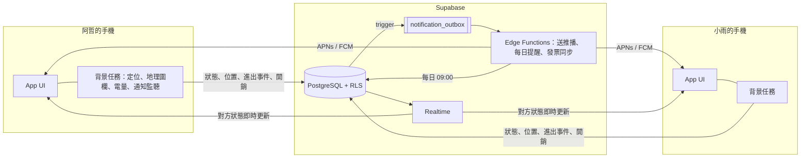

# 小倆口：情侶 App 設計文件

> 一條紅線，牽起兩個人的日常。

本文件是「小倆口」的產品與技術設計，涵蓋功能規格、資訊架構、隱私原則、系統架構、資料模型、平台限制與開發順序。對應的可操作原型在 [`prototype/`](../prototype)，資料庫結構在 [`backend/schema.sql`](../backend/schema.sql)。

---

## 1. 產品概要

### 1.1 定位

給已經在一起的兩個人用的 App。它不取代 LINE，而是補上聊天軟體做不到的部分：**不用開口就知道對方的狀態**（在哪、電量、心情、花了什麼），以及**把在一起的日子記下來**（紀念日、約會、經期、歷史紀錄）。

### 1.2 目標使用者

- 18–35 歲、交往中或已婚的伴侶，兩人都用智慧型手機（iOS / Android 混用很常見）。
- 首發市場台灣：繁體中文、新台幣、LINE Pay / 街口 / 信用卡通知、雲端發票載具、農曆生日。

### 1.3 設計原則

| 原則 | 具體做法 |
|---|---|
| **雙向同意** | 兩人各自安裝、各自配對、各自決定分享哪些資料；沒有「單方面追蹤」的模式。 |
| **透明** | 對方看得到你分享了什麼、何時改了設定；對方新增會偵測你的地點時，你一定收到通知（不能關）。 |
| **可以暫停** | 任何時候可以暫停分享 1 小時或到今天結束，對方看到的是「暫停中、幾點恢復」，不是「失聯」。 |
| **有趣，而不是監控** | 開銷用「猜花費」包裝成遊戲；心情不好時引導「安撫」，而不是質問。 |
| **資料最少化** | 位置只存最新一筆，不保留軌跡；Wi-Fi 名稱不上傳；經期症狀只有本人看得到。 |

### 1.4 功能地圖

| 模組 | 功能 | 版本 |
|---|---|---|
| 帳號與配對 | Apple / Google / 手機號碼登入、6 碼配對碼、QR Code、解除配對 | MVP |
| 對方手機狀態 | 電量與充電、網路類型、螢幕／最後使用、專注模式、今日步數、裝置型號 | MVP |
| 位置與標點 | 即時位置、雙方距離、地點標記（地理圍欄）、抵達／離開通知 | MVP |
| 心情 | 9 種心情 + 備註、7 天心情紀錄、心情不好時提示安撫 | MVP |
| 安撫 | 抱抱、摸摸頭、親親、我在、加油、請你喝 + 悄悄話 | MVP |
| 紀念日 | 在一起天數、生日、週年、每 100 天／520／1314 里程碑、提前提醒 | MVP |
| 日曆與約會 | 月曆、約會邀請／答應／婉拒、提醒、同步系統行事曆 | MVP |
| 經期 | 記錄經期、預測下次經期、排卵日、易孕期、相對安全期、關懷提醒 | MVP |
| 歷史紀錄 | 所有互動的時間軸、分類篩選、匯出 | MVP |
| 自動記帳 | 付款通知解析（Android）、捷徑交易自動化（iOS）、雲端發票載具、手動記帳 | v1.1 |
| 猜花費 | 對方開放猜的消費先隱藏金額，猜完揭曉、計分 | v1.1 |
| 其他 | 桌面小工具、深色模式、資料匯出、帳號刪除、共同相簿、願望清單 | 依序加入 |

---

## 2. 資訊架構

底部 5 個分頁，其他功能從首頁卡片或「我的」進入。

```
首頁 ─┬─ 對方的手機（電量／網路／螢幕／位置／步數）
      ├─ 今天的心情 ── 安撫（彈出面板）
      ├─ 快速功能：安撫｜猜花費｜經期｜紀念日
      ├─ 經期關懷提醒（經期前後才出現）
      ├─ 接下來（約會、紀念日、里程碑、經期預測）
      └─ 最近動態 ── 歷史紀錄
地圖 ─┬─ 地圖（我、對方、紅線距離、標點範圍）
      └─ 標點列表 ── 新增／編輯標點
帳本 ─┬─ 對方的帳本：近 30 天統計、猜猜看、消費明細
      └─ 我的帳本：統計、記一筆、付款通知、隱私標籤
日曆 ─┬─ 月曆（約會、紀念日、里程碑、經期／易孕期／排卵日）
      ├─ 當日詳情 ── 新增約會
      └─ 接下來的約會（答應／婉拒）
我的 ─┬─ 個人資料與配對碼
      ├─ 心情紀錄、紀念日、經期、歷史紀錄
      ├─ 分享與隱私、通知設定
      └─ 解除配對
```

首次開啟的流程：暱稱 → 配對（給出自己的配對碼或輸入對方的） → 逐項選擇要分享的資料、經期功能要記錄誰、在一起的日子 → 首頁。

---

## 3. 功能規格

### 3.1 帳號與配對

**登入**：Sign in with Apple、Google、手機號碼簡訊驗證（Supabase Auth）。

**配對**

1. A 產生 6 碼配對碼（字元集排除易混淆的 `I O 0 1`，共 32 個字元），24 小時內有效，同一時間只有一組有效碼；也可以顯示為 QR Code。
2. B 輸入配對碼（不分大小寫）→ 伺服器在同一個交易中建立 couple、加入兩位成員、標記邀請已使用。
3. 兩人各自進入「決定要分享什麼」頁面；資料庫預設除了心情以外**全部不分享**，必須逐項開啟。
4. 一個人同時只能有一段有效配對（資料庫唯一索引保證，也擋掉兩人同時接受邀請的競態）。

**解除配對**：任一方可以解除，所有共享立即停止（權限判斷只認尚未離開的配對）。共同資料（標點、紀念日、約會、歷史紀錄）保留 30 天，期間雙方重新配對可以復原，之後永久刪除。對方會收到通知。

**邊界情況**：配對碼過期或已使用 → 「配對碼無效，請對方重新產生」；輸入自己的碼 → 提示輸入對方的；已有配對的人嘗試配對 → 先解除原配對。

### 3.2 對方手機狀態

| 項目 | iOS 做法 | Android 做法 | 顯示 |
|---|---|---|---|
| 電量、充電中 | `UIDevice.batteryLevel / batteryState` | `BatteryManager` | 百分比 + 量條；≤ 20% 紅色 |
| 網路 | `NWPathMonitor`（Wi-Fi／行動網路） | `ConnectivityManager` | Wi-Fi 時顯示所在標點名稱（「公司」），**不上傳 SSID** |
| 螢幕／最後使用 | 只能知道最後一次使用 App 的時間 | 前景服務中接收 `SCREEN_ON/OFF` | 使用中／已關閉 + 相對時間 |
| 專注模式 | Focus Status API（授權後只知道是否在專注模式） | `getCurrentInterruptionFilter()` | 「通知靜音中」 |
| 今日步數 | CoreMotion `CMPedometer` | 計步感測器／Health Connect | 數字 |
| 裝置型號 | `UIDevice` | `Build.MODEL` | 卡片右上角 |

**更新頻率**：App 開啟時、地理圍欄或顯著位置變化喚醒時、系統排程的背景更新（iOS `BGAppRefreshTask`、Android `WorkManager`，最短約 15 分鐘）。因為系統不保證背景頻率，畫面一律標示「更新於 N 分鐘前」，避免讓人誤以為是即時資料。

**低電量通知**：電量從 > 20% 降到 ≤ 20% 且沒有在充電時通知對方一次；回到 30% 以上才會再次觸發（資料庫 trigger 判斷，見 `tg_device_status_changed`）。

### 3.3 位置與地點標記

**即時位置**：只保存每人最新一筆（`locations` 表，一人一列），不保存移動軌跡。首頁與地圖顯示「在 ○○」「步行中」「搭捷運中」與兩人距離；地圖上兩人之間畫一條紅線，中間標示距離。

**「現在在哪？」**：打開對方地圖時，伺服器對對方手機送一則背景推播請它回報位置。iOS 的背景推播有頻率限制，屬於盡力而為；失敗時顯示最後已知位置與時間。

**地點標記（地理圍欄）**

- 欄位：名稱、圖示、中心點、半徑 50–2000 公尺（建議 ≥ 100 公尺，GPS 才穩定）、偵測誰（對方／我／兩人）、抵達通知、離開通知。
- **在被偵測者的手機上判斷**（iOS Region Monitoring、Android Geofencing API），事件回報到 `place_events`，由資料庫 trigger 寫入歷史並通知對方。
- **防抖動**：進入條件是距離 ≤ 半徑；離開條件是距離 > 半徑 + 緩衝（半徑的 20%，至少 25 公尺），避免在邊界飄移時反覆觸發（`geofenceStep()`，有單元測試）。正式版另加停留時間門檻（例如連續 2 分鐘）。
- **數量限制**：iOS 每個 App 最多監測 20 個區域、Android 最多 100 個。一對情侶上限 20 個標點，超過時優先監測離目前位置最近的。
- **透明度**：新增會偵測對方的標點時，對方一定收到「○○ 新增了地點『公司』，你抵達或離開時對方會收到通知」，這則通知不能關閉；被偵測的人也可以修改或刪除這個標點。
- 暫停分享或關閉位置分享時，手機不再回報進出事件（資料庫的 RLS 也會拒絕寫入）。

### 3.4 自動記帳

| 來源 | 平台 | 原理 | 使用者要做的事 |
|---|---|---|---|
| 付款通知 | Android | `NotificationListenerService` 讀取 LINE Pay、街口、銀行 App 的通知，用規則解析金額與商家 | 在系統設定開啟「通知存取權」 |
| 捷徑交易自動化 | iOS 17+ | 「捷徑」的個人自動化「交易」觸發（Apple Pay 刷卡時），把商家與金額傳給 App 的 App Intent | 安裝我們提供的捷徑並開啟自動化（一次） |
| 雲端發票載具 | 兩者 | 財政部電子發票整合服務平台 API，依手機條碼查詢發票明細 | 輸入手機條碼與驗證碼（需先向財政部申請 API 使用權） |
| 拍收據 | 兩者 | OCR 辨識金額與商家 | 拍照 |
| 手動 | 兩者 | — | 輸入 |

> iOS 不允許 App 讀取其他 App 的通知，所以 iOS 的自動化程度取決於捷徑與發票載具。不使用讀取簡訊權限：Google Play 只允許預設簡訊 App 等少數類別使用。

**解析與分類**：`parseNotification()` 抽出金額（`NT$`、`新台幣`、`元`）、商家（`商店：`、`給`、`於…消費`、`交易：`）與來源；`categorize()` 以商家關鍵字分成咖啡飲料、餐飲、交通、日用、購物、娛樂、禮物、其他。使用者手動改過的分類會記成「商家 → 類別」規則，下次自動套用。

**去重**：同一筆交易可能從通知與發票各進來一次。以 `dedupe_key`（金額 + 時間 10 分鐘區間 + 商家正規化）判斷，同一使用者的唯一索引保證不重複。

**隱私控制**

- 單筆可見度：**看得到**、**不給看**、**禮物模式**（選一個日期，那天之後對方才看得到，避免驚喜被拆穿）。
- 整個類別不給看（例如「禮物」）。
- 暫停分享期間的消費不會出現在對方帳本。
- 對方讀取開銷只能透過 `partner_expenses()`，資料表本身只開放給本人，才能在伺服器端遮住待猜的金額。

### 3.5 猜花費

1. 消費的擁有者可以把某一筆設成「開放猜金額」（也可以設定特定類別自動開放，例如咖啡）。
2. 對方的帳本裡，這筆只顯示商家、類別、時間與來源，金額顯示為「猜」。
3. 猜的時候提供提示：「○○ 在『咖啡飲料』平均每筆 NT$142」。
4. 送出後由伺服器計分（`submit_guess()`），每筆只能猜一次，擁有者會收到通知。

| 誤差 | 分數 | 評語 |
|---|---|---|
| ≤ 3% | 100 | 神準！心有靈犀 |
| ≤ 10% | 80 | 超懂你 |
| ≤ 25% | 50 | 很接近了 |
| ≤ 50% | 20 | 差了一點 |
| > 50% | 5 | 要多了解對方喔 |

帳本頁顯示總分、猜過次數與平均誤差。之後可加入每月排行、徽章（連續 7 天 80 分以上）。

### 3.6 心情

- 9 種心情：開心、甜蜜、平靜、想你、好累、焦慮、難過、生氣、不舒服，可加 100 字備註。
- 一天可以更新多次，首頁顯示當天最新的一筆；心情頁顯示兩人 7 天的心情。
- 設定後對方收到通知；負面心情（好累、焦慮、難過、生氣、不舒服）的通知與首頁會出現「要不要安撫一下？」。

### 3.7 安撫與悄悄話

- 6 種安撫：抱抱、摸摸頭、親親、我在、加油、請你喝，加上選填的悄悄話（200 字）。
- 對方收到推播，iOS 使用 Communication Notification（顯示傳送者頭像）；對方可以一鍵回覆貼圖式的回應。
- 10 分鐘內最多 20 次，避免洗版（資料庫 trigger 限制）。
- 定位為「輕量互動」，不做完整聊天室，因為情侶多半已經用 LINE 聊天。

### 3.8 紀念日

- 自動：在一起第 N 天（開始那天算第 1 天）、每 100 天、第 520 天、第 1314 天。
- 手動：生日、第一次約會、自訂；可設每年重複、提醒時間（當天／前 1 天／前 3 天／前 7 天）。
- 2/29 的紀念日在平年以 2/28 提醒。
- 支援農曆日期：App 每年換算成國曆後再排提醒（台灣很多人過農曆生日）。
- 兩人都會收到提醒。每日排程 `daily_reminders()` 在台灣時間 09:00 執行。

### 3.9 日曆與約會

- 月曆同時標示：約會（點）、紀念日（紅點）、里程碑（琥珀點）、經期（粉底）、預測經期（虛線框）、易孕期（紫底）、排卵日（紫框）。
- 約會欄位：標題、日期時間、地點（可選標點或自由輸入）、備註、提醒時間。
- 狀態：提議 → 答應／婉拒；對方提議的約會在日曆與首頁出現「答應」「婉拒」按鈕，結果通知提議的人。
- 答應後可同步到系統行事曆（iOS EventKit、Android CalendarContract）。

### 3.10 經期、排卵期、安全期

**誰記錄**：設定「記錄我的」或「記錄對方的」。資料屬於有週期的那個人，由她決定是否分享給對方、是否允許對方幫忙記錄開始與結束日期。同性伴侶或兩人都有週期的情況，各自記錄各自的。

**預測演算法**（`prototype/core.js`，有單元測試）

1. 週期長度 = 最近 6 個週期的平均；短於 15 天或長於 60 天的間隔視為漏記，不納入。沒有資料時預設 28 天。
2. 經期天數 = 最近 6 次經期的平均，預設 5 天。使用者也可以手動指定兩者。
3. 下次經期 = 最近一次開始日 + 週期長度。
4. 排卵日 = 下次經期 − 14 天（黃體期長度，可調整 10–16 天）。
5. 易孕期 = 排卵日前 5 天到後 1 天。
6. 其餘日子標為「相對安全期」，再細分濾泡期／黃體期。
7. 預測日過了還沒記錄：一個週期內顯示「經期已延遲 N 天」（超過 7 天建議驗孕或就醫）；超過一整個週期沒記錄，視為忘記記錄，預測往後推。
8. 最近週期長短相差超過 7 天時，提示「預測可能不準」。

**畫面**：週期圓環（每天一格，依階段上色，標出今天）、距離下次經期天數、本週期排卵日、易孕期、紀錄列表。給記錄者本人：流量與症狀（經痛、腰痠、頭痛、脹氣、情緒低落、疲倦、想吃甜食、長痘痘），**只有本人看得到**。給伴侶：依階段給的貼心提醒（經前多一點耐心、準備熱飲等），以及經期前 2 天的關懷推播。

**必要聲明**：「安全期」不是可靠的避孕方法，排卵可能提前或延後；畫面上固定顯示這段說明，並建議使用保險套等方式避孕、週期異常時諮詢醫師。App 不宣稱任何醫療用途。

### 3.11 歷史紀錄

- 所有互動寫入 `activity_log`：配對、抵達／離開、心情、安撫與回覆、猜花費、約會、紀念日、低電量、分享設定變更、經期記錄。
- 依日期分組、可依類別篩選（位置、心情、安撫、開銷、約會、手機、經期、分享），保留一年，可匯出 CSV / JSON。
- 位置只記錄抵達與離開標點的事件，不保存移動軌跡。
- 首頁鈴鐺顯示對方產生的新動態數量。

### 3.12 通知總表

| 事件 | 收到的人 | 範例 | 預設 | 可關閉 |
|---|---|---|---|---|
| 抵達／離開標點 | 對方 | 小雨 已抵達 小雨公司 | 開 | 可，也可逐個標點設定 |
| 對方新增偵測你的標點 | 被偵測的人 | 阿哲 新增了地點「公司」 | 開 | **不可** |
| 分享設定變更、暫停 | 對方 | 小雨 更新了分享設定 | 開 | **不可** |
| 心情更新 | 對方 | 小雨 現在覺得難過，要不要安撫一下？ | 開 | 可 |
| 安撫、悄悄話 | 對方 | 阿哲 給了你一個大大的抱抱 | 開 | 可 |
| 低電量 | 對方 | 小雨 的手機電量剩 18% | 開 | 可 |
| 有開銷可以猜／對方猜了 | 對方／擁有者 | 小雨 有一筆開銷等你猜 | 開 | 可 |
| 對方每一筆開銷 | 對方 | 小雨 在 全家 消費 NT$65 | **關** | 可 |
| 約會邀請、答應、婉拒 | 對方 | 小雨 約你：看電影 | 開 | 可 |
| 紀念日、里程碑 | 兩人 | 小雨生日，還有 7 天 | 開 | 可 |
| 經期關懷 | 伴侶 | 小雨 的經期預計 2 天後開始 | 開 | 可（由記錄者決定是否發送） |
| 配對、解除配對 | 對方 | 已解除配對 | 開 | 不可 |

推播一律先寫入 `notification_outbox`，由 Edge Function 依 `notification_prefs` 過濾後送 APNs / FCM，方便重送與除錯。

### 3.13 其他基本功能

- 個人資料：暱稱、頭像、生日、時區。
- 深色模式（跟隨系統）、字級跟隨系統設定、VoiceOver / TalkBack 標籤。
- 桌面小工具：在一起天數、對方電量與位置、下一個紀念日。
- 帳號刪除（App Store 要求）：刪除個人資料，並觸發解除配對。
- 資料匯出：個人資料與歷史紀錄。
- 語系：繁體中文（首發），預留英文。

---

## 4. 隱私、安全與同意

情侶 App 處理的是最敏感的資料：即時位置、消費、健康（經期）。產品能不能被信任，取決於這一節。

1. **雙方各自同意**：沒有任何資料可以在對方沒開啟的情況下被看到。預設只分享心情，其他逐項開啟。
2. **權限在資料庫層執行**：每張表都開啟 Row Level Security。對方能讀的條件寫成 `partner_shares(owner, 'location')`：必須是目前配對中的伴侶、擁有者開啟該項分享、且沒有暫停。App 端的程式錯誤也不會洩漏資料（`backend/tests/rls_smoke.sql` 有 40 項測試）。
3. **看得到彼此分享了什麼**：分享設定對方可讀；任何變更都通知對方；暫停時顯示恢復時間。
4. **反濫用**：
   - 不提供隱藏 App 圖示、隱藏通知、偷偷開啟分享等功能；Android 分享位置時常駐前景服務通知。
   - 任何一方都可以一鍵暫停或解除配對，解除立即生效。
   - 在「分享與隱私」頁提供求助資訊：如果覺得被迫分享，可以撥打 113 保護專線。
5. **資料最少化**：位置只存最新一筆；Wi-Fi 只回報「是否連到 Wi-Fi」；經期症狀與筆記不分享；開銷可以整類隱藏。
6. **加密**：傳輸 TLS；資料庫靜態加密；只有本人看得到的經期症狀與筆記另做應用層加密（金鑰存在裝置 Keychain / Keystore，伺服器只存密文）。
7. **保存期限**：歷史紀錄 1 年；解除配對後共同資料 30 天；刪除帳號後 30 天內清除備份。
8. **法規**：個人資料保護法（台灣）、GDPR（若開放歐盟）；隱私權政策逐項列出蒐集目的。經期資料視為健康資料，不用於廣告、不提供第三方。

---

## 5. 技術架構

### 5.1 技術選型

| 層 | 選擇 | 理由 |
|---|---|---|
| App | React Native + Expo（prebuild）+ TypeScript | 一套程式碼同時出 iOS / Android；`expo-location`（含背景定位與地理圍欄）、`expo-battery`、`expo-notifications`、`expo-task-manager`、`expo-sensors`（計步）都有現成模組 |
| 原生模組 | Kotlin（通知監聽）、Swift（App Intents、Focus Status、Widget） | 這幾項沒有跨平台套件 |
| 地圖 | `react-native-maps`（iOS Apple Maps、Android Google Maps） | 免費額度高，原生體驗 |
| 後端 | Supabase：PostgreSQL、Auth、Realtime、Edge Functions、Storage | RLS 適合「只有伴侶能看」的權限模型；Realtime 讓首頁狀態即時更新 |
| 推播 | APNs、FCM（經由 Edge Function） | 需要 Communication Notification 與背景推播 |
| 共用邏輯 | `core.js`（週期預測、地理圍欄、計分、通知解析） | App、Edge Function（Deno）、原型共用同一套程式與測試 |

### 5.2 架構圖



### 5.3 背景任務與省電

- **位置**：平常只用「顯著位置變化」加上地理圍欄，不持續開 GPS；只有打開地圖或「現在在哪？」請求時才短暫要求高精度定位。
- **回報節流**：位置移動少於 50 公尺、電量變化少於 2% 時不上傳。
- **Android**：分享位置期間使用前景服務（常駐通知「正在與小雨分享位置」），符合系統與 Google Play 的背景定位規定。
- **iOS**：使用 Always 定位權限，但第一次只要求 When In Use，等使用者建立第一個標點時再請求 Always，並說明用途。

### 5.4 資料模型

完整定義與 RLS 見 [`backend/schema.sql`](../backend/schema.sql)。

| 表 | 用途 | 誰能讀 |
|---|---|---|
| `profiles` | 暱稱、頭像、生日 | 本人、伴侶 |
| `couples` / `couple_members` | 配對關係（`left_at` 為空代表有效） | 成員 |
| `pair_invites` | 配對碼 | 產生者 |
| `sharing_settings` | 各項分享開關、隱藏類別、暫停到何時 | 本人、伴侶 |
| `device_status` | 電量、網路、螢幕、專注模式、步數 | 本人；伴侶需對方分享手機狀態且未暫停 |
| `locations` | 最新位置（一人一列） | 本人；伴侶需對方分享位置且未暫停 |
| `places` / `place_events` | 標點與進出事件 | 配對雙方 |
| `expenses` / `expense_guesses` | 開銷與猜測 | 本人；伴侶只能透過 `partner_expenses()` |
| `moods` | 心情 | 本人；伴侶需對方分享心情 |
| `comforts` | 安撫與悄悄話 | 傳送與接收的人 |
| `anniversaries` / `events` | 紀念日、約會 | 配對雙方 |
| `cycle_settings` / `cycle_periods` | 週期設定與經期紀錄 | 本人；伴侶需對方分享經期 |
| `cycle_logs` | 流量、症狀、筆記 | **只有本人** |
| `activity_log` | 歷史紀錄 | 配對雙方 |
| `notification_prefs` / `push_tokens` | 通知偏好、推播 token | 本人 |
| `notification_outbox` | 待送推播 | 只有伺服器 |

主要 RPC：`create_invite()`、`accept_invite(code)`、`unpair()`、`pause_sharing(minutes)`、`partner_expenses(from, to)`、`submit_guess(expense, amount)`、`daily_reminders(date)`。

### 5.5 平台限制對照

| 功能 | iOS | Android |
|---|---|---|
| 背景定位 | 需 Always 權限；系統決定喚醒時機 | Android 10+ 背景定位需另外授權，並在 Play Console 申報用途 |
| 地理圍欄數量 | 每個 App 20 個 | 每個 App 100 個 |
| 讀取其他 App 通知（自動記帳） | 不允許，改用捷徑交易自動化 | 通知存取權 |
| 螢幕開關狀態 | 不允許，只能顯示最後使用 App 的時間 | 前景服務內可接收 |
| 專注模式 | 只知道是否專注中 | 可讀勿擾模式 |
| 背景更新頻率 | 不保證 | WorkManager 最短 15 分鐘 |

### 5.6 上架審查注意事項

- **App Store**：5.1.1 資料蒐集需取得同意並說明用途；5.1.2 不得將資料用於其他目的；5.1.3 經期屬健康資料，不得用於廣告；5.1.5 定位必須與功能直接相關。
- **Google Play**：背景定位權限申報與影片說明；監控類 App 政策：本 App 必須明確呈現為「雙方各自安裝、互相分享」，不可宣傳為監控伴侶，App 圖示不可隱藏、分享時要有常駐通知。上架前建議請法務確認文案。

---

## 6. 開發里程碑

| 階段 | 範圍 | 完成條件 |
|---|---|---|
| 0. 原型驗證 | 本 repo 的互動原型、資料庫結構與測試 | 找 5–8 對情侶試用原型，確認功能優先序與文案 |
| 1. MVP | 登入、配對、分享設定、手機狀態、位置與標點、心情、安撫、紀念日、日曆、經期、歷史紀錄、推播 | 兩支不同平台的手機配對後，所有通知都在 1 分鐘內送達；背景定位一天耗電 < 5% |
| 2. 記帳 | Android 通知記帳、iOS 捷徑、手動記帳、猜花費、禮物模式 | 常見 5 種付款通知解析正確率 > 95% |
| 3. 擴充 | 雲端發票載具、桌面小工具、農曆、資料匯出、共同相簿、願望清單 | 依試用回饋排序 |

---

## 7. 原型與測試

| 項目 | 位置 | 執行 |
|---|---|---|
| 互動原型 | `prototype/index.html` | 直接用瀏覽器開啟。右側（手機上在「我的 › 示範控制台」）可以模擬對方：移動到某地點、心情變差、電量剩 19%、刷卡消費、約你出去、暫停分享 |
| 核心邏輯單元測試 | `prototype/core.test.js` | `npm test`（17 項：日期、紀念日、週期預測、地理圍欄、計分、通知解析） |
| 資料庫權限測試 | `backend/tests/rls_smoke.sql` | `npm run test:db`（需要本機 PostgreSQL 15+，40 項：配對、分享、暫停、猜花費、經期隱私、解除配對、每日提醒） |

原型的地圖是虛構街區，所有人物與金額都是示範資料，只存在瀏覽器的 localStorage。

---

## 8. 待決定事項

1. **名稱**：「小倆口」是暫定名，需確認商標。
2. **商業模式**：建議免費版涵蓋所有核心功能，訂閱制提供進階項目（無限歷史紀錄、共同相簿空間、主題、小工具樣式），不賣廣告，以維持「資料不給第三方」的承諾。
3. **聊天**：是否需要完整聊天室，或維持「悄悄話」的輕量互動。
4. **資料存放區域**：Supabase 專案建在東京或新加坡區域，延遲與法規需確認。
5. **發票 API**：需以公司名義向財政部申請，確認申請資格與時程。
