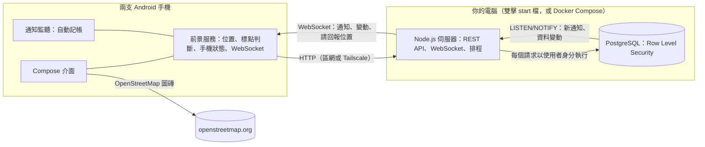

# 小倆口：情侶 App 設計文件

> 一條紅線，牽起兩個人的日常。

小倆口是給已經在一起的兩個人用的 **Android App**，伺服器與資料庫**架在你自己的電腦上**。它不取代 LINE，而是補上聊天軟體做不到的部分：**不用開口就知道對方的狀態**（在哪、電量、心情、花了什麼），以及**把在一起的日子記下來**（紀念日、約會、經期、歷史紀錄）。

| 文件 | 內容 |
|---|---|
| 本文件 | 產品、介面風格、功能規格、隱私原則、系統架構 |
| [SELF_HOSTING.md](SELF_HOSTING.md) | 在自己電腦架伺服器、手機連線、權限、備份 |
| [`android/`](../android) | Android App 原始碼（Kotlin + Jetpack Compose） |
| [`server/`](../server) | 自架伺服器與資料庫結構 |

---

## 1. 設計原則

| 原則 | 具體做法 |
|---|---|
| **雙向同意** | 兩人各自安裝、各自配對、各自決定分享哪些資料；資料庫預設除了心情以外都不分享。 |
| **透明** | 對方看得到你分享了什麼、何時改了設定；對方新增會偵測你的標點時，你一定收到通知（不能關）。 |
| **可以暫停** | 任何時候可以暫停分享 1 小時、3 小時或到今天結束；對方看到「暫停中、幾點恢復」，不是「失聯」。 |
| **有趣，而不是監控** | 開銷包裝成「猜花費」遊戲；對方心情不好時引導「安撫」，而不是質問。 |
| **資料留在自己家** | 伺服器與資料庫在自己的電腦，不經過任何雲端；不用 Firebase，地圖用 OpenStreetMap。 |
| **資料最少化** | 位置只存最新一筆，不保留軌跡；Wi-Fi 名稱不上傳；經期症狀只有本人看得到。 |

---

## 2. 介面風格：可愛、溫柔、會動

**配色**：櫻花粉為主色，搭配薄荷、薰衣草、奶油黃、天空藍等粉嫩色；兩個人各有代表色（我：天空藍、對方：櫻花粉），在頭像、地圖、帳本裡一致使用。支援深色模式（深莓色底）。

**字型**：全 App 使用 jf open 粉圓（Huninn，SIL OFL 授權），圓潤的繁體中文字型。

**形狀**：大圓角卡片（26dp）、膠囊按鈕、圓滾滾的圖示底；底部分頁是懸浮的圓角膠囊。

**圖示**：Material Rounded 圖示 + 大量 emoji（心情、安撫、類別、標點、提醒都有專屬表情），避開 Android 8–10 不支援的新 emoji。

**吉祥物**：兩顆麻糬（藍色是我、粉色是對方），中間一條紅線牽著跳動的愛心。會上下晃、會眨眼；對方心情不好時，粉色麻糬會嘟嘴掉眼淚。出現在首頁、歡迎頁、配對頁、等待連線頁。

**動畫**（全部用 Compose 原生動畫，不需要額外素材）：

| 動畫 | 用在哪裡 |
|---|---|
| 按下去「啵」一下縮小再彈回來（spring） | 所有按鈕、卡片、標籤、分頁 |
| 愛心飄起來 | 送出安撫、收到抱抱、答應約會、新增紀念日 |
| 彩色紙花 | 猜花費猜到 80 分以上 |
| 心跳放大 | 品牌愛心、在一起天數、紀念日當天 |
| 數字滾動 | 在一起天數、帳本總額、猜花費分數 |
| 長條圖依序長出來 | 帳本類別統計 |
| 經期圓環一格一格畫出來 | 經期頁 |
| 電池動畫 | 電量條動態填滿；低電量變紅並抖動；充電時閃電跳動 |
| 左右搖擺 | 選中的心情、「猜！」標籤、空狀態的小圖 |
| 通知卡片從上方彈下來 | App 在前景時收到通知 |
| 頁面切換、月份切換的滑動 | 導覽、日曆 |
| 底部分頁圖示彈跳上升 | 切換分頁 |

---

## 3. 資訊架構

```
首頁 ─┬─ 吉祥物 + 在一起第 N 天 + 對方在哪、相距多遠
      ├─ 對方的手機（電量／網路／螢幕與勿擾／位置／步數、「現在在哪？」）
      ├─ 今天的心情（雙方）＋「要不要安撫一下？」
      ├─ 快速功能：安撫｜猜花費｜經期｜紀念日
      ├─ 經期關懷提醒（經期前後才出現）
      ├─ 接下來（約會、紀念日、里程碑、經期預測）
      └─ 最近動態
地圖 ─┬─ OpenStreetMap：兩人頭像、紅線、標點範圍圈（長按新增標點）
      └─ 標點列表（偵測誰、半徑、抵達／離開通知、對方在這）
帳本 ─┬─ 對方的帳本：近 30 天統計、猜猜看、明細、禮物模式提示
      └─ 我的帳本：統計、記一筆、測試自動記帳、隱私標籤
日曆 ─┬─ 月曆（約會、紀念日、里程碑、經期／預測經期／易孕期／排卵日）
      ├─ 當天詳情 ── 在這天約會
      └─ 接下來的約會（答應／婉拒）
我的 ─┬─ 心情紀錄、紀念日、經期、歷史紀錄
      ├─ 分享與隱私、通知設定、權限與背景執行、伺服器與帳號
      └─ 解除配對（示範模式：示範控制台、離開示範模式）
```

第一次開啟：歡迎頁 → 連接伺服器（填網址、測試連線）→ 註冊或登入 → 配對 → 決定要分享什麼 → 開啟權限 → 首頁。也可以選「先看看示範」，不需要伺服器就能體驗全部畫面，並在示範控制台扮演對方。

---

## 4. 功能規格

### 4.1 帳號與配對

- 帳號密碼登入（密碼以 scrypt 雜湊，登入權杖以 HMAC 簽章；改密碼會讓舊的登入全部失效）。
- 伺服器預設最多 2 個帳號（`MAX_USERS`），兩個人都註冊後別人就無法註冊。
- 配對碼 6 碼（排除易混淆的 `I O 0 1`），24 小時內有效；可以一鍵用 LINE 等 App 傳給對方。
- 一個人同時只能有一段有效配對（資料庫唯一索引保證）。
- 解除配對：所有共享立即停止，共同資料保留 30 天後刪除，對方會收到通知。

### 4.2 對方的手機狀態

| 項目 | 做法 | 顯示 |
|---|---|---|
| 電量、充電中 | `BatteryManager` | 動態電池條；≤ 20% 變紅抖動 |
| 網路 | `ConnectivityManager` | Wi-Fi 時顯示所在標點名稱（「公司」），**不上傳 SSID** |
| 螢幕 | 前景服務接收 `SCREEN_ON/OFF` | 使用中／休息中＋最後使用時間 |
| 勿擾 | `NotificationManager.currentInterruptionFilter` | 「勿擾中」 |
| 今日步數 | 計步感測器（需「體能活動」權限） | 數字 |
| 裝置型號 | `Build.MANUFACTURER + MODEL` | 卡片右上角 |

前景服務在狀態改變時（插拔電、螢幕開關、網路切換、勿擾切換）與每 5 分鐘回報一次；畫面一律標示「更新於 N 分鐘前」。電量從 > 20% 降到 ≤ 20% 且沒充電時通知對方一次。

### 4.3 位置與標點（地理圍欄）

- 位置只存每人最新一筆。前景服務用 Fused Location（平衡耗電模式，每 1 分鐘、移動 20 公尺以上才更新），移動 25 公尺以上或每 4 分鐘才上傳。
- **「現在在哪？」**：伺服器經由 WebSocket 請對方手機立刻高精度定位並回報。
- 標點：名稱、圖示、半徑 50–500 公尺、偵測誰（對方／我／兩人）、抵達通知、離開通知。
- **在被偵測者的手機上判斷進出**：進入條件是距離 ≤ 半徑；離開條件是距離 > 半徑 + 緩衝（半徑的 20%，至少 25 公尺），避免 GPS 在邊界飄移時反覆觸發。精確度差於 150 公尺的定位不拿來判斷。
- 新增會偵測對方的標點時，對方一定收到通知（不能關），被偵測的人也可以修改或刪除。
- 暫停或關閉位置分享時，手機不再回報，資料庫的權限規則也會拒絕寫入。

### 4.4 自動記帳

| 來源 | 原理 |
|---|---|
| 付款通知 | `NotificationListenerService` 讀取 LINE Pay、街口、銀行 App 的通知；必須同時有「付款／消費／交易／扣款／刷卡／支付」字眼與金額才記帳，避免把聊天訊息裡的金額當成消費 |
| 手動 | 記一筆：商家、金額、類別（自動判斷，可改） |
| 測試 | 「測試自動記帳」可以貼一則通知看解析結果 |

- 解析：金額（`NT$`、`新台幣`、`元`）、商家（`商店：`、`給`、`於…消費`、`交易：`）、來源；依商家關鍵字分成 8 類。
- 去重：同一筆交易被通知兩次時，以「金額＋商家＋10 分鐘區間」的雜湊值去重（資料庫唯一索引）。
- 隱私：單筆可設「看得到／不給看／禮物模式（到指定日期才讓對方看到）」，也可以整類隱藏；暫停分享期間的消費不出現在對方帳本。

### 4.5 猜花費

開放猜的消費在對方帳本只顯示商家、類別、時間，金額藏起來；**伺服器在對方猜之前不回傳金額**，計分也在伺服器算。

| 誤差 | 分數 | 評語 |
|---|---|---|
| ≤ 3% | 100 | 神準！心有靈犀 |
| ≤ 10% | 80 | 超懂你 |
| ≤ 25% | 50 | 很接近了 |
| ≤ 50% | 20 | 差了一點 |
| > 50% | 5 | 要多了解對方喔 |

猜的時候提示「對方在這個類別平均每筆多少」；每筆只能猜一次；帳本顯示總分、猜過次數、平均誤差。

### 4.6 心情與安撫

- 9 種心情（開心、甜蜜、平靜、想你、好累、焦慮、難過、生氣、不舒服）＋100 字備註，顯示兩人 7 天的心情。
- 負面心情時對方首頁出現「要不要安撫一下？」，吉祥物也會跟著難過。
- 6 種安撫（抱抱、摸摸頭、親親、我在、加油、請你喝）＋悄悄話；送出時飄愛心。10 分鐘內最多 20 次。

### 4.7 紀念日與約會

- 自動：在一起第 N 天、每 100 天、520、1314 里程碑。
- 手動：生日、第一次約會、自訂；每年重複；提醒當天／前 1／3／7 天；2/29 在平年以 2/28 提醒。
- 約會：標題（附常見點子）、日期時間、地點（可選標點）、備註、提醒；對方答應或婉拒都會通知；約會前依設定提醒兩人。

### 4.8 經期、排卵期、安全期

**誰的資料**：有週期的人記錄自己的經期，並決定要不要分享給伴侶、要不要讓伴侶幫忙記錄開始／結束日期。

**預測演算法**（App、伺服器、網頁原型三處相同，都有單元測試）：

1. 週期長度 = 最近 6 個週期的平均；15–60 天以外的間隔視為漏記。預設 28 天。
2. 經期天數 = 最近 6 次的平均，預設 5 天。
3. 下次經期 = 最近一次開始日 + 週期長度；排卵日 = 下次經期 − 14 天。
4. 易孕期 = 排卵日前 5 天到後 1 天；其他日子為「相對安全期」（再分濾泡期／黃體期）。
5. 預測日過了還沒記錄：一個週期內顯示「延遲 N 天」（≥ 7 天建議驗孕或就醫）；超過一整個週期視為忘記記錄。
6. 最近週期長短相差超過 7 天時提示「預測可能不準」。

**畫面**：動畫週期圓環、距離下次經期、本週期排卵日、易孕期、紀錄列表。記錄者本人可以記流量與症狀（**只有本人看得到**）；伴侶看到依階段變化的貼心提醒，並在經期預計開始前 2 天收到關懷通知。

**固定聲明**：「安全期」不是可靠的避孕方法，需要避孕請使用保險套等方式，週期異常請諮詢醫師。

### 4.9 歷史紀錄與通知

所有互動寫入 `activity_log`，可依位置、心情、安撫、開銷、約會、手機、分享篩選。

| 事件 | 收到的人 | 可關閉 |
|---|---|---|
| 抵達／離開標點 | 對方 | 可（也可逐個標點設定） |
| 對方新增偵測你的標點、分享設定變更 | 被影響的人 | **不可** |
| 心情、抱抱與悄悄話、低電量、猜花費 | 對方 | 可 |
| 約會邀請、答應、提醒；紀念日；經期關懷 | 對方或兩人 | 可 |

App 在前景時以卡片顯示，在背景時以系統通知顯示（分成「抱抱與心情」「抵達與離開」「約會與紀念日」三個頻道，可在系統設定分別調整聲音）。

---

## 5. 隱私與安全

1. **權限在資料庫層執行**：伺服器替每個請求開一個交易並切換成該使用者身分，PostgreSQL 的 Row Level Security 決定能讀寫哪些資料。對方能讀的條件是：目前配對中、擁有者開啟該項分享、沒有暫停。
2. **資料在自己電腦**：資料庫只開放給伺服器與電腦本機；建議用 Tailscale 讓手機在外面也能安全連線，不要直接開放到網際網路。
3. **反濫用**：沒有隱藏 App、偷偷開啟分享的功能；分享位置時常駐通知；任一方都能一鍵暫停或解除配對；分享頁提供 113 保護專線資訊。
4. **最少化**：位置不留軌跡、Wi-Fi 名稱不上傳、經期症狀不分享、開銷可整類隱藏。

---

## 6. 系統架構



| 層 | 選擇 | 理由 |
|---|---|---|
| App | Kotlin、Jetpack Compose、Material 3 | 只做 Android，原生 API（前景服務、通知監聽、計步）最完整；Compose 動畫好寫 |
| 網路 | Retrofit + kotlinx.serialization、OkHttp WebSocket | |
| 定位 | Google Play 服務 Fused Location | 省電、室內也準 |
| 地圖 | osmdroid（OpenStreetMap） | 免 API 金鑰、免費 |
| 本機設定 | DataStore | 伺服器網址、登入權杖、標點進出狀態、步數基準 |
| 伺服器 | Node.js（只依賴 `pg`、`ws`） | 輕量，Windows／macOS／Linux 都能跑 |
| 架設 | 雙擊啟動檔（`server/scripts/launcher.js`）；或 Docker Compose | 第一次用 PostgreSQL 管理員密碼建立專用帳號 `xlk`（非超級使用者）與資料庫，之後直接啟動；每天自動備份 |
| 資料庫 | PostgreSQL 13 以上（建議最新版） | RLS 讓權限寫在資料庫裡；trigger 寫歷史紀錄與通知 |
| 通知 | 資料庫 `notification_outbox` → `pg_notify` → WebSocket → App 回 ack | 不需要 Firebase；離線期間的通知在重新連線時補送 |
| 排程 | 伺服器每分鐘：約會提醒；每天 09:00：紀念日、里程碑、經期關懷 | |

**背景執行**：連到伺服器時啟動前景服務（Android 14 以上用 `location`＋`remoteMessaging` 類型），保持 WebSocket 並回報狀態。需要使用者把電池最佳化設為「不限制」，部分品牌另需允許自動啟動。

**資料模型**：見 [`server/db/migrations/002_schema.sql`](../server/db/migrations/002_schema.sql)，主要資料表為 profiles、couples、couple_members、pair_invites、sharing_settings、device_status、locations、places、place_events、expenses、expense_guesses、moods、comforts、anniversaries、events、cycle_settings、cycle_periods、cycle_logs、activity_log、notification_prefs、notification_outbox。

---

## 7. 測試

| 測試 | 指令 | 內容 |
|---|---|---|
| App 核心邏輯 | `cd android && ./gradlew testDebugUnitTest` | 經期預測、地理圍欄、猜花費、付款通知解析、紀念日（與 JS 版相同案例） |
| App 畫面 | `./gradlew recordRoborazziDebug` | 不需模擬器，把每個畫面（含深色模式）畫成圖片 |
| App ↔ 伺服器 | `XLK_TEST_SERVER=http://127.0.0.1:18080 ./gradlew testDebugUnitTest` | App 的資料層對真的伺服器走完配對、狀態、通知、標點、記帳、猜花費、約會、經期、解除配對 |
| 伺服器 | `npm run test:server` | 40 項資料庫權限測試＋13 項 API / WebSocket 端對端測試＋啟動程式的單元測試 |
| 共用邏輯（JS） | `npm test` | 17 項 |

---

## 8. 之後可以做

- 桌面小工具：在一起天數、對方電量與位置。
- 共同相簿、願望清單。
- 農曆生日（每年換算成國曆）。
- 雲端發票載具匯入（需向財政部申請 API）。
- 伺服器管理頁：在瀏覽器裡備份、還原、重設密碼（目前用啟動檔的參數）。
